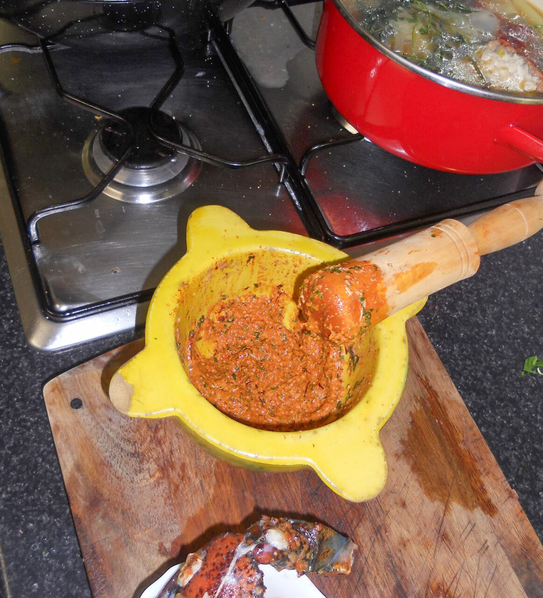

# Picada catalana

*Foto: [PachuliYo](https://commons.wikimedia.org/wiki/File:Picada_catalana.jpg), [CC BY-SA 4.0](https://creativecommons.org/licenses/by-sa/4.0/deed.es), vía Wikimedia Commons.*

Majado de frutos secos, ajo, pan frito y perejil que se añade al final de los guisos catalanes para espesarlos y darles sabor.

🥄 Para **un guiso de 4 personas** · ⏱️ 10 minutos · Dificultad: fácil

*In English:* [Catalan nut and garlic paste](picada.en.md)

## Ingredientes

- 15 almendras tostadas
- 10 avellanas tostadas
- 2 dientes de ajo
- 1 rebanada de pan frito en aceite de oliva
- 1 ramita de perejil
- Unas hebras de azafrán (opcional)
- 2–3 cucharadas de caldo del guiso

## Preparación

1. **El pan.** Fríe la rebanada de pan en aceite hasta que esté dorada.
2. **Machacar.** En el mortero, machaca los ajos con el perejil y el azafrán.
3. **Los frutos secos.** Añade las almendras, las avellanas y el pan troceado y machaca hasta tener una pasta gruesa.
4. **Diluir.** Añade el caldo y remueve. Incorpórala al guiso en los últimos 5–10 minutos de cocción.

## Consejos

- **Para** guisos de carne, suquets de pescado, albóndigas con sepia o caracoles.
- **Variantes:** con piñones, chocolate negro, galleta maría o hígado frito, según el guiso.
- **No la cuezas mucho:** se pierde el aroma.
