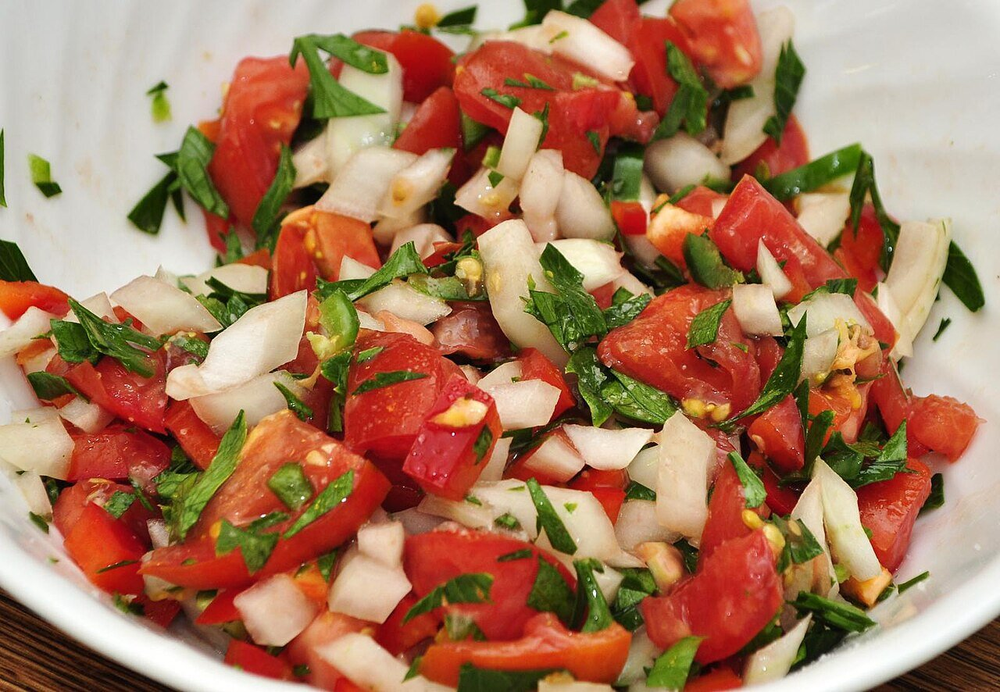

# Pico de gallo (fresh Mexican salsa)

*Photo: [jeffreyw](https://commons.wikimedia.org/wiki/File:Mmm..._Pico_de_Gallo_(5923456035).jpg), [CC BY 2.0](https://creativecommons.org/licenses/by/2.0/), via Wikimedia Commons.*

Chopped tomato, onion and cilantro with lime and salt: Mexico's fresh salsa. With the chile seeded, or left out, it's barely spicy.

🥄 Serves **4** · ⏱️ 10 minutes · Difficulty: easy · Heat: mild

*En español:* [Pico de gallo (salsa mexicana)](pico-de-gallo.es.md)

## Ingredients

- 4 ripe but firm tomatoes
- ½ white onion
- 1 handful cilantro
- Juice of 1 lime
- ½ jalapeño or serrano chile, seeded (optional)
- Salt

## Directions

1. **Chop.** Dice the tomato small and finely chop the onion, cilantro and chile, if using.
2. **Mix.** Combine everything in a bowl with the lime juice and salt.
3. **Rest.** Let it sit 10 minutes so the juices release and the flavors blend.

## Tips

- **Serve with** tacos, tortilla chips, eggs, fish or grilled meat.
- **Milder onion:** soak it 5 minutes in cold water and drain.
- **Best the same day,** freshly made.
