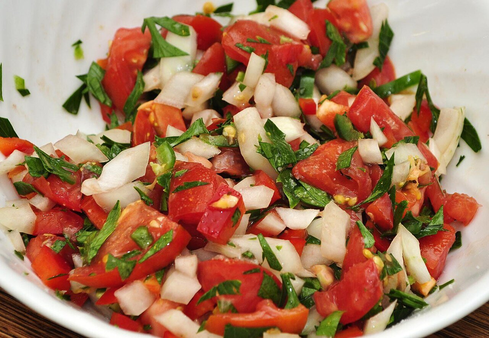

# Pico de gallo (salsa mexicana)

*Foto: [jeffreyw](https://commons.wikimedia.org/wiki/File:Mmm..._Pico_de_Gallo_(5923456035).jpg), [CC BY 2.0](https://creativecommons.org/licenses/by/2.0/deed.es), vía Wikimedia Commons.*

Tomate, cebolla y cilantro picados con lima y sal: la salsa fresca mexicana. Con el chile sin semillas, o sin él, casi no pica.

🥄 Para **4 personas** · ⏱️ 10 minutos · Dificultad: fácil · Picor: suave

*In English:* [Pico de gallo (fresh Mexican salsa)](pico-de-gallo.en.md)

## Ingredientes

- 4 tomates maduros pero firmes
- ½ cebolla blanca
- 1 puñado de cilantro
- El zumo de 1 lima
- ½ chile jalapeño o serrano sin semillas (opcional)
- Sal

## Preparación

1. **Picar.** Pica el tomate en dados pequeños, la cebolla muy fina, el cilantro y el chile, si lo usas.
2. **Mezclar.** Mezcla todo en un bol con el zumo de lima y la sal.
3. **Reposar.** Déjalo 10 minutos para que suelte jugo y se mezclen los sabores.

## Consejos

- **Con** tacos, totopos, huevos, pescado o carne asada.
- **Cebolla más suave:** remójala 5 minutos en agua fría y escúrrela.
- **Mejor del día,** recién hecho.
