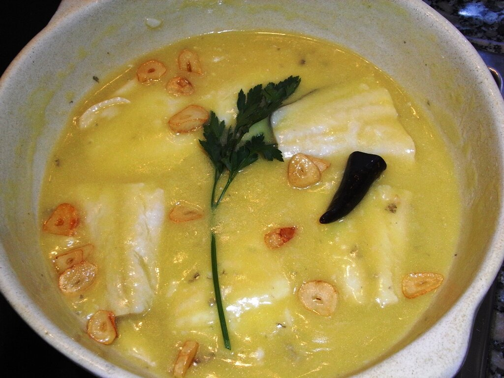

# Basque olive oil and salt cod emulsion

*Photo: [Javier Lastras from España/Spain](https://commons.wikimedia.org/wiki/File:Bacalao-pil-pil-02-jlastras.jpg), [CC BY 2.0](https://creativecommons.org/licenses/by/2.0/), via Wikimedia Commons.*

A Basque emulsion of olive oil and the natural gelatin of salt cod, bound only by motion.

🥄 Serves **4** · ⏱️ 40 minutes (plus soaking) · Difficulty: hard

*En español:* [Salsa pil-pil](pil-pil.es.md)

## Ingredients

- 4 desalted salt cod fillets, skin on (about 1¾ lb)
- 1 cup mild olive oil
- 4 garlic cloves
- 1 small dried chile

## Directions

1. **Desalt.** If using salt cod, soak it 36–48 hours in the fridge, changing the water every 8 hours. Pat it very dry.
2. **Flavor the oil.** In a clay or heavy pan, gently fry the sliced garlic and chile in the oil. Remove them and let the oil cool to about 140–160 °F.
3. **Poach.** Add the cod skin side up and cook over very low heat for 5–8 minutes without boiling. It will release a white gelatin.
4. **Emulsify.** Remove the cod. Swirl the pan back and forth (or whisk with a small strainer in circles) until the oil and gelatin emulsify into a thick, pale sauce.
5. **Serve.** Return the cod, warm for a minute while swirling, and top with the garlic and chile.

## Tips

- **Temperature is everything:** oil that's too hot won't draw out the gelatin, and the sauce won't come together.
- **If it won't bind,** add a splash of the liquid the cod releases and keep swirling.
- **Hake or cod cheeks** (kokotxas) are made the same way.
