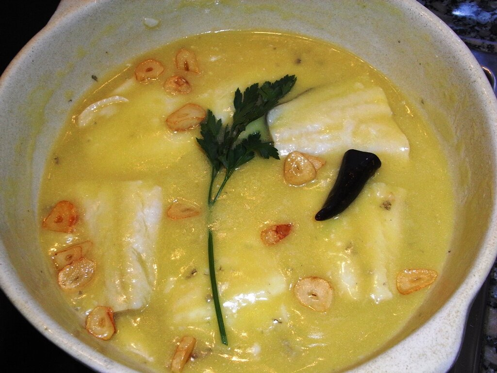

# Salsa pil-pil

*Foto: [Javier Lastras from España/Spain](https://commons.wikimedia.org/wiki/File:Bacalao-pil-pil-02-jlastras.jpg), [CC BY 2.0](https://creativecommons.org/licenses/by/2.0/deed.es), vía Wikimedia Commons.*

Emulsión vasca de aceite de oliva y la gelatina del bacalao, ligada solo con movimiento.

🥄 Para **4 personas** · ⏱️ 40 minutos (más el desalado) · Dificultad: difícil

*In English:* [Basque olive oil and salt cod emulsion](pil-pil.en.md)

## Ingredientes

- 4 lomos de bacalao desalado con piel (unos 800 g)
- 250 ml de aceite de oliva suave
- 4 dientes de ajo
- 1 guindilla

## Preparación

1. **Desalar.** Si el bacalao es salado, desálalo 36–48 horas en la nevera cambiando el agua cada 8 horas. Sécalo bien.
2. **Aromatizar.** En una cazuela de barro, dora suavemente los ajos laminados y la guindilla en el aceite. Retíralos y deja templar el aceite hasta unos 60–70 °C.
3. **Confitar.** Pon el bacalao con la piel hacia arriba y cuécelo a fuego muy suave 5–8 minutos, sin que hierva. Irá soltando gelatina blanca.
4. **Ligar.** Retira el bacalao. Mueve la cazuela en vaivén (o bate con un colador en círculos) hasta que el aceite y la gelatina emulsionen y la salsa quede espesa y blanquecina.
5. **Servir.** Vuelve a meter el bacalao en la salsa, calienta un minuto moviendo y adorna con los ajos y la guindilla.

## Consejos

- **La clave es la temperatura:** si el aceite está muy caliente, no suelta gelatina y no liga.
- **Si no liga:** añade un chorrito del agua que suelta el bacalao y sigue moviendo.
- **Con kokotxas** de merluza o bacalao se hace igual.
