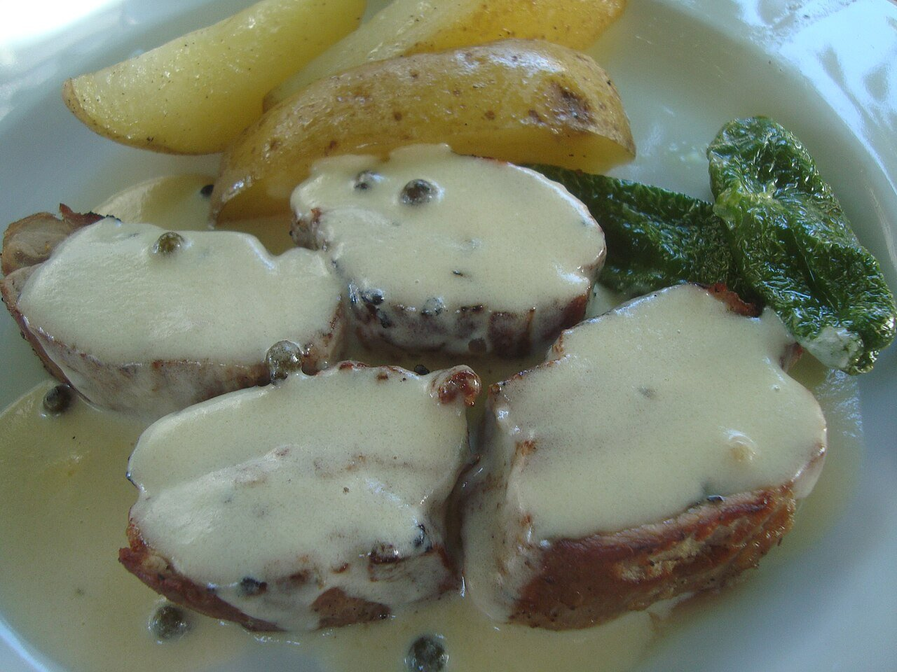

# Peppercorn brandy cream sauce

*Photo: [Juan Emilio Prades Bel](https://commons.wikimedia.org/wiki/File:Solomillo_ib%C3%A9rico_con_salsa_a_la_pimienta.jpg), [CC BY-SA 4.0](https://creativecommons.org/licenses/by-sa/4.0/), via Wikimedia Commons.*

Black or green peppercorns, brandy, stock and cream: the sauce for Spanish pepper-crusted tenderloin and rib-eye.

🥄 Serves **4** · ⏱️ 15 minutes · Difficulty: easy

*En español:* [Salsa a la pimienta](pimienta.es.md)

## Ingredients

- 1 tablespoon black peppercorns (or 2 tablespoons green peppercorns in brine)
- 1 shallot
- 3½ tablespoons Spanish brandy
- Scant ½ cup beef stock
- ¾ cup plus 1 tablespoon heavy cream
- 1½ tablespoons butter
- Salt

## Directions

1. **Pepper.** Coarsely crack the black peppercorns in a mortar. If using green ones, drain and lightly crush them.
2. **Base.** In the pan you seared the meat in, cook the chopped shallot in the butter for 2–3 minutes. Add the pepper and toast 30 seconds.
3. **Brandy.** Off the heat, add the brandy and carefully flambé it, or simmer 2 minutes to cook off the alcohol.
4. **Reduce.** Add the stock and reduce by half.
5. **Cream.** Add the cream and simmer 3–4 minutes, until thick. Season with salt and spoon over the meat.

## Tips

- **Green peppercorns** are milder and more aromatic; black ones are hotter.
- **Serve with** pork or beef tenderloin, rib-eye or chicken breast, and fries.
- **Control the heat** with the amount of pepper, not the cooking time.
