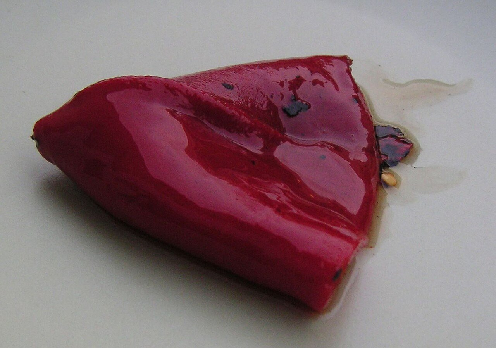

# Piquillo pepper cream sauce

*Photo: [Slastic](https://commons.wikimedia.org/wiki/File:Pimiento_piquillo.jpg), public domain, via Wikimedia Commons.*

Roasted piquillo peppers, slowly cooked onion and oat milk: a creamy sauce that is vegan and alcohol-free. The photo shows the piquillo pepper, not the sauce.

🥄 Serves **4** · ⏱️ 20 minutes · Difficulty: easy

*En español:* [Salsa de piquillos](piquillo.es.md)

## Ingredients

- 1 jar or can roasted piquillo peppers (about 9 oz)
- 1 onion
- 1 garlic clove
- ⅔ cup unsweetened oat milk (or vegetable stock)
- 1 pinch sugar
- 3 tablespoons olive oil
- Salt

## Directions

1. **Soften.** Gently cook the chopped onion and garlic in the oil for about 10 minutes.
2. **Peppers.** Add the drained peppers (save their juice) and cook 5 minutes.
3. **Blend.** Add the oat milk, sugar and salt and blend until very smooth. Thin with the pepper juice if needed.
4. **Heat.** Bring to a boil for 2 minutes and adjust the salt.

## Tips

- **Serve with** pasta, rice, tofu, chickpeas or roasted vegetables.
- **Cold,** it works as a spread or dip.
- **For stuffed peppers,** fill more piquillos with sautéed vegetables and coat them with the sauce.
