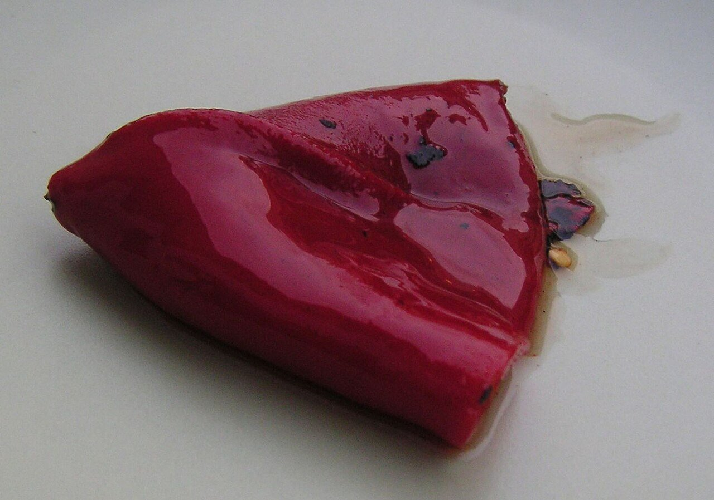

# Salsa de piquillos

*Foto: [Slastic](https://commons.wikimedia.org/wiki/File:Pimiento_piquillo.jpg), dominio público, vía Wikimedia Commons.*

Pimientos del piquillo asados, cebolla pochada y bebida de avena: una salsa cremosa, vegana y sin alcohol. La foto muestra el pimiento del piquillo, no la salsa.

🥄 Para **4 personas** · ⏱️ 20 minutos · Dificultad: fácil

*In English:* [Piquillo pepper cream sauce](piquillo.en.md)

## Ingredientes

- 1 lata de pimientos del piquillo asados (unos 250 g)
- 1 cebolla
- 1 diente de ajo
- 150 ml de bebida de avena sin azúcar (o caldo de verduras)
- 1 pizca de azúcar
- 3 cucharadas de aceite de oliva
- Sal

## Preparación

1. **Pochar.** Pocha la cebolla y el ajo picados en el aceite a fuego suave unos 10 minutos.
2. **Los piquillos.** Añade los pimientos escurridos (guarda su jugo) y cocina 5 minutos.
3. **Triturar.** Añade la bebida de avena, el azúcar y la sal y tritura hasta que quede muy fina. Si está espesa, aclárala con el jugo de los pimientos.
4. **Calentar.** Dale un hervor de 2 minutos y ajusta de sal.

## Consejos

- **Con** pasta, arroz, tofu, garbanzos o verduras asadas.
- **Fría** sirve como crema para untar o mojar.
- **Si los quieres rellenos,** rellena otros piquillos con verduras salteadas y nápalos con la salsa.
