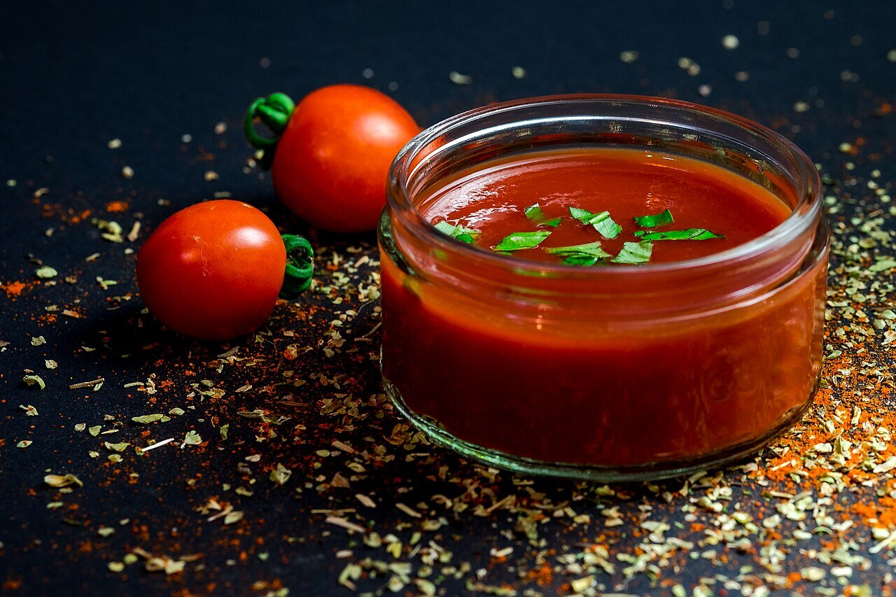

# Italian tomato and basil sauce

*Photo: [Dennis Klein klein2](https://commons.wikimedia.org/wiki/File:Fresh_Tomato_Sauce_(Unsplash).jpg), [CC0](https://creativecommons.org/publicdomain/zero/1.0/), via Wikimedia Commons.*

Tomato, garlic, olive oil and basil: the simplest Italian tomato sauce, vegan and alcohol-free.

🥄 Serves **4** · ⏱️ 30 minutes · Difficulty: easy

*En español:* [Salsa al pomodoro](pomodoro.es.md)

## Ingredients

- 1 can (28 oz) whole peeled tomatoes (San Marzano if possible), or ripe peeled tomatoes
- 2 garlic cloves
- 4 tablespoons extra virgin olive oil
- 1 sprig fresh basil
- Salt

## Directions

1. **Garlic.** Warm the oil over low heat with the peeled, crushed garlic until lightly golden. Remove it for a milder flavor.
2. **Tomato.** Add the hand-crushed tomatoes and a pinch of salt.
3. **Simmer.** Simmer over medium-low heat 20–25 minutes, stirring now and then, until thick and the oil starts to separate.
4. **Basil.** At the end, add the basil leaves torn by hand.

## Tips

- **Use with** spaghetti, on pizza, in lasagna, eggplant parmigiana or meatballs.
- **Sweeter:** add half an onion during cooking and remove it at the end.
- **Finish the pasta in the sauce** with a splash of cooking water.
