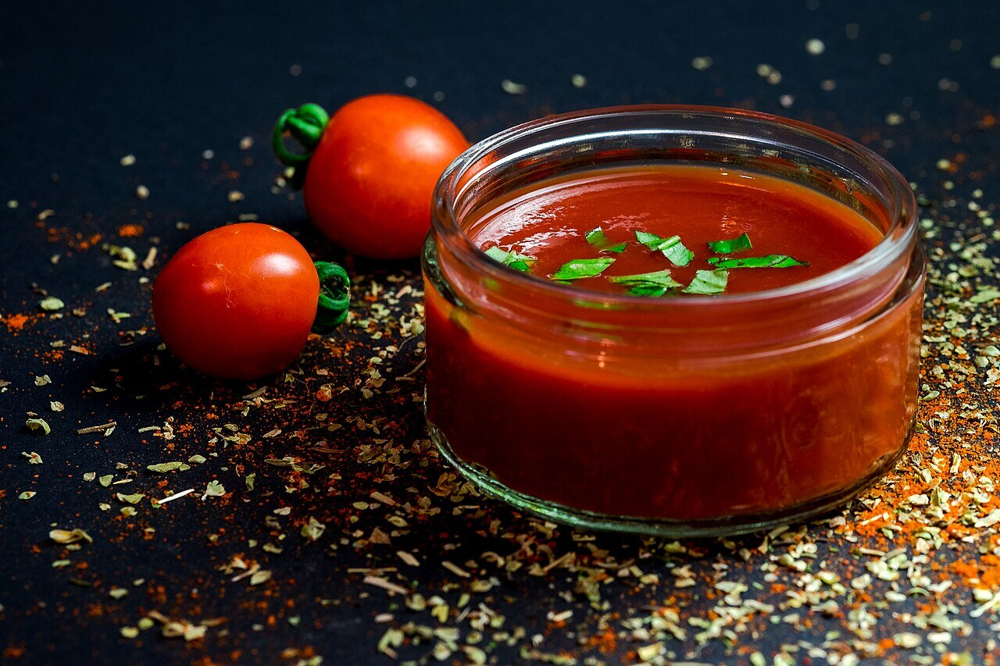

# Salsa al pomodoro

*Foto: [Dennis Klein klein2](https://commons.wikimedia.org/wiki/File:Fresh_Tomato_Sauce_(Unsplash).jpg), [CC0](https://creativecommons.org/publicdomain/zero/1.0/deed.es), vía Wikimedia Commons.*

Tomate, ajo, aceite de oliva y albahaca: la salsa italiana de tomate más sencilla, vegana y sin alcohol.

🥄 Para **4 personas** · ⏱️ 30 minutos · Dificultad: fácil

*In English:* [Italian tomato and basil sauce](pomodoro.en.md)

## Ingredientes

- 800 g de tomate pelado en lata (mejor San Marzano), o tomates maduros pelados
- 2 dientes de ajo
- 4 cucharadas de aceite de oliva virgen extra
- 1 ramita de albahaca fresca
- Sal

## Preparación

1. **El ajo.** Calienta el aceite a fuego suave con los ajos pelados y aplastados hasta que se doren un poco. Retíralos si quieres un sabor suave.
2. **El tomate.** Añade el tomate triturado a mano y una pizca de sal.
3. **Cocer.** Cuece a fuego medio-suave 20–25 minutos, removiendo de vez en cuando, hasta que espese y el aceite empiece a separarse.
4. **La albahaca.** Al final, añade las hojas de albahaca rotas con la mano.

## Consejos

- **Con** espaguetis, en pizza, lasaña, berenjenas a la parmesana o albóndigas.
- **Más dulce:** añade media cebolla entera durante la cocción y retírala al final.
- **Termina la pasta en la salsa** con un poco de agua de cocción.
