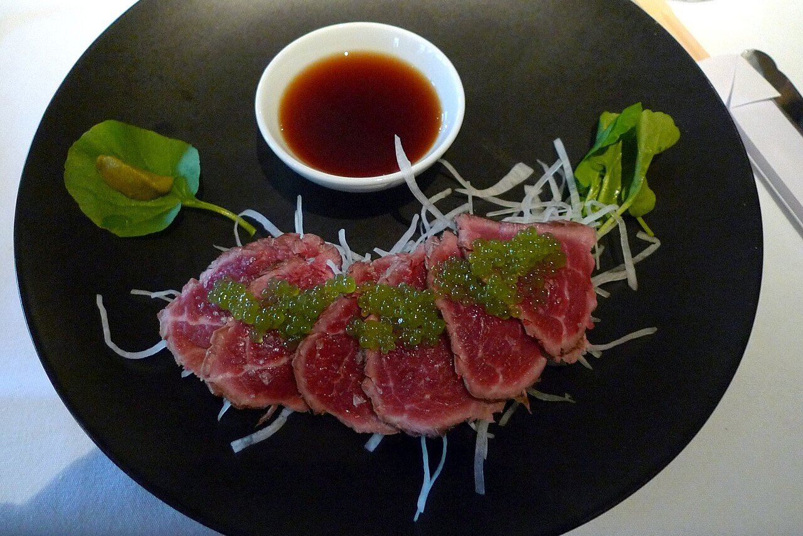

# Japanese citrus soy sauce

*Photo: [Ruth Hartnup from Vancouver, Canada](https://commons.wikimedia.org/wiki/File:Canada_Prime_Beef_Tataki_with_ponzu_pearls_and_horseradish_(5895881268).jpg), [CC BY 2.0](https://creativecommons.org/licenses/by/2.0/), via Wikimedia Commons.*

Soy sauce, citrus juice, rice vinegar and mirin, infused with kombu and katsuobushi: the tangy sauce for shabu-shabu, tataki and fish.

🥄 Makes **about 1¼ cups** · ⏱️ 10 minutes (plus 24 h resting) · Difficulty: easy

*En español:* [Ponzu (salsa japonesa de cítricos)](ponzu.es.md)

## Ingredients

- Scant ½ cup soy sauce
- ¼ cup yuzu juice (or half lemon, half lime)
- 2 tablespoons rice vinegar
- 2 tablespoons mirin
- 1 piece kombu seaweed, 2 inches
- 1 handful katsuobushi (dried bonito flakes)

## Directions

1. **Mirin.** Heat the mirin in a small saucepan for 1 minute to cook off the alcohol. Let it cool.
2. **Mix.** In a jar, combine the soy sauce, citrus juice, vinegar and mirin.
3. **Infuse.** Add the kombu and katsuobushi, cover and refrigerate 24 hours.
4. **Strain.** Strain and keep the sauce in the fridge.

## Tips

- **Serve with** shabu-shabu, beef or tuna tataki, gyoza, grilled fish or grated daikon.
- **Vegan:** skip the katsuobushi and keep only the kombu.
- **Alcohol-free:** replace the mirin with 1 tablespoon sugar dissolved in water.
