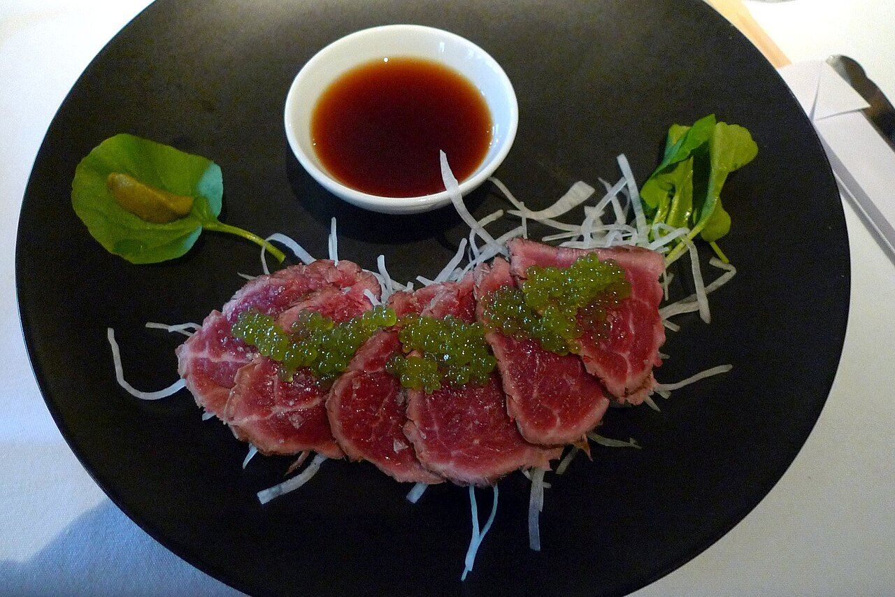

# Ponzu (salsa japonesa de cítricos)

*Foto: [Ruth Hartnup from Vancouver, Canada](https://commons.wikimedia.org/wiki/File:Canada_Prime_Beef_Tataki_with_ponzu_pearls_and_horseradish_(5895881268).jpg), [CC BY 2.0](https://creativecommons.org/licenses/by/2.0/deed.es), vía Wikimedia Commons.*

Salsa de soja, zumo de cítricos, vinagre de arroz y mirin, infusionados con kombu y katsuobushi: la salsa ácida del shabu-shabu, el tataki y el pescado.

🥄 Para **unos 300 ml** · ⏱️ 10 minutos (más 24 h de reposo) · Dificultad: fácil

*In English:* [Japanese citrus soy sauce](ponzu.en.md)

## Ingredientes

- 100 ml de salsa de soja
- 60 ml de zumo de yuzu (o mitad limón y mitad lima)
- 2 cucharadas de vinagre de arroz
- 2 cucharadas de mirin
- 1 trozo de alga kombu de 5 cm
- 1 puñado de katsuobushi (copos de bonito seco)

## Preparación

1. **El mirin.** Calienta el mirin en un cazo 1 minuto para que se evapore el alcohol. Déjalo enfriar.
2. **Mezclar.** En un tarro, mezcla la soja, el zumo, el vinagre y el mirin.
3. **Infusionar.** Añade el kombu y el katsuobushi, tapa y deja en la nevera 24 horas.
4. **Colar.** Cuela y guarda la salsa en la nevera.

## Consejos

- **Con** shabu-shabu, tataki de ternera o de atún, gyozas, pescado a la plancha o daikon rallado.
- **Vegana:** quita el katsuobushi y deja solo el kombu.
- **Sin alcohol:** cambia el mirin por 1 cucharada de azúcar disuelta en agua.
