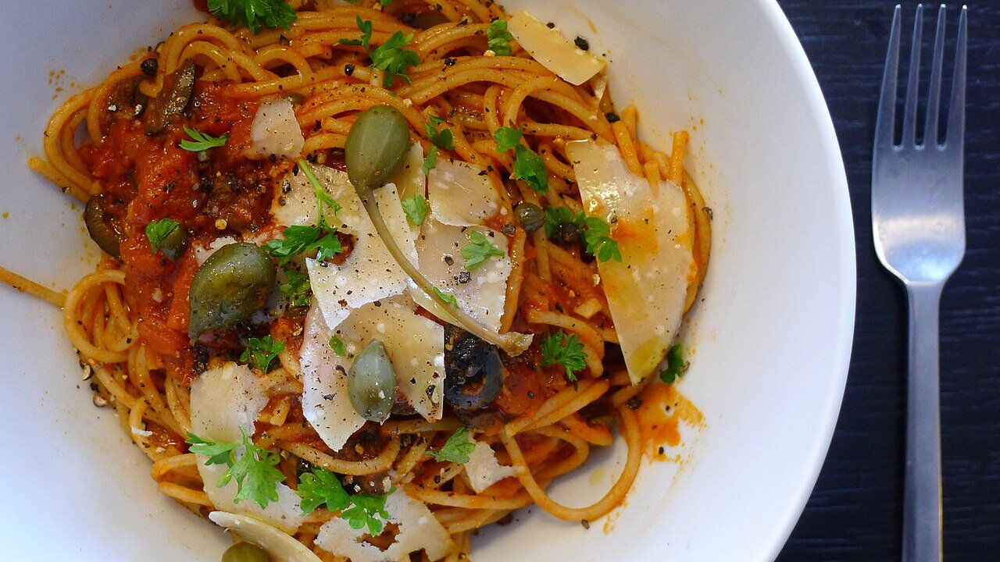

# Puttanesca sauce

*Photo: [Kai Olav Fredriksen](https://commons.wikimedia.org/wiki/File:Spaghetti_alla_Puttanesca.jpg), [CC BY-SA 4.0](https://creativecommons.org/licenses/by-sa/4.0/), via Wikimedia Commons.*

Tomato, garlic, anchovies, black olives and capers: the Neapolitan pantry sauce, bold and briny.

🥄 Serves **4** · ⏱️ 25 minutes · Difficulty: easy

*En español:* [Salsa puttanesca](puttanesca.es.md)

## Ingredients

- 1 can (14 oz) whole peeled tomatoes
- 2 garlic cloves
- 4 anchovy fillets in oil
- ½ cup pitted black olives (Gaeta if possible)
- 1 tablespoon capers, rinsed
- 1 small dried chile (optional)
- 1 tablespoon chopped parsley
- 4 tablespoons olive oil
- 14 oz spaghetti

## Directions

1. **Base.** Warm the oil over low heat with the sliced garlic, chile and anchovies, mashing them until they melt.
2. **Tomato.** Add the hand-crushed tomatoes and simmer 10 minutes.
3. **The rest.** Add the chopped olives and capers and simmer 5 more minutes.
4. **Pasta.** Toss the al dente spaghetti in the sauce with a splash of pasta water and finish with parsley.

## Tips

- **No salt needed:** anchovies, olives and capers season it.
- **No cheese:** it's traditionally served without parmesan.
- **Without anchovies** it becomes vegan, though it loses some depth.
