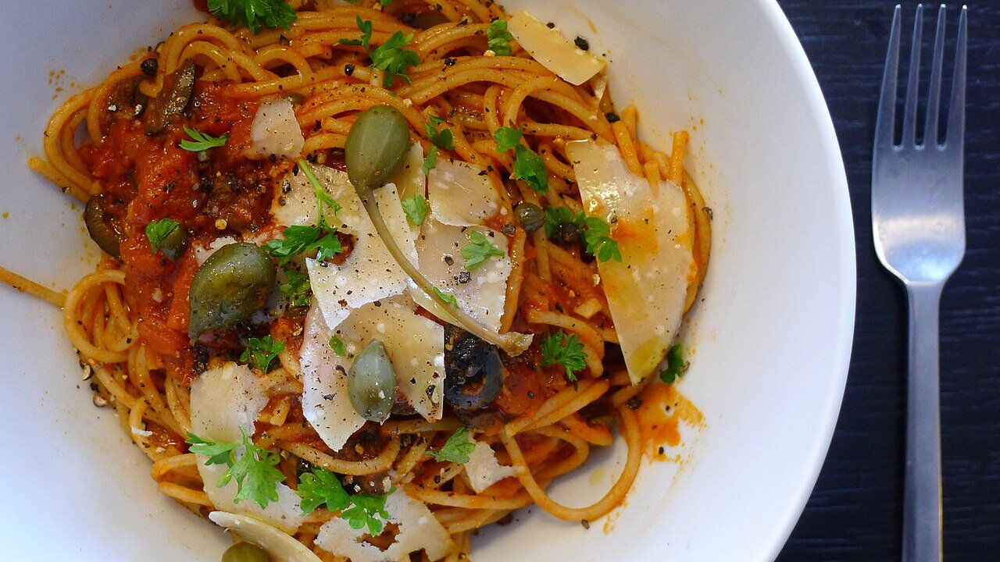

# Salsa puttanesca

*Foto: [Kai Olav Fredriksen](https://commons.wikimedia.org/wiki/File:Spaghetti_alla_Puttanesca.jpg), [CC BY-SA 4.0](https://creativecommons.org/licenses/by-sa/4.0/deed.es), vía Wikimedia Commons.*

Tomate, ajo, anchoas, aceitunas negras y alcaparras: la salsa napolitana de despensa, intensa y salada.

🥄 Para **4 personas** · ⏱️ 25 minutos · Dificultad: fácil

*In English:* [Puttanesca sauce](puttanesca.en.md)

## Ingredientes

- 400 g de tomate pelado en lata
- 2 dientes de ajo
- 4 filetes de anchoa en aceite
- 80 g de aceitunas negras (mejor de Gaeta), sin hueso
- 1 cucharada de alcaparras, desaladas
- 1 guindilla seca pequeña (opcional)
- 1 cucharada de perejil picado
- 4 cucharadas de aceite de oliva
- 400 g de espaguetis

## Preparación

1. **La base.** Calienta el aceite a fuego suave con el ajo laminado, la guindilla y las anchoas, aplastándolas hasta que se deshagan.
2. **El tomate.** Añade el tomate triturado a mano y cuece 10 minutos.
3. **El resto.** Añade las aceitunas en trozos y las alcaparras y cuece 5 minutos más.
4. **La pasta.** Saltea los espaguetis al dente en la salsa con un poco de su agua y termina con el perejil.

## Consejos

- **No hace falta sal:** las anchoas, las aceitunas y las alcaparras ya salan la salsa.
- **Sin queso:** es tradicional servirla sin parmesano.
- **Sin anchoas** se vuelve vegana, aunque pierde parte de su sabor.
