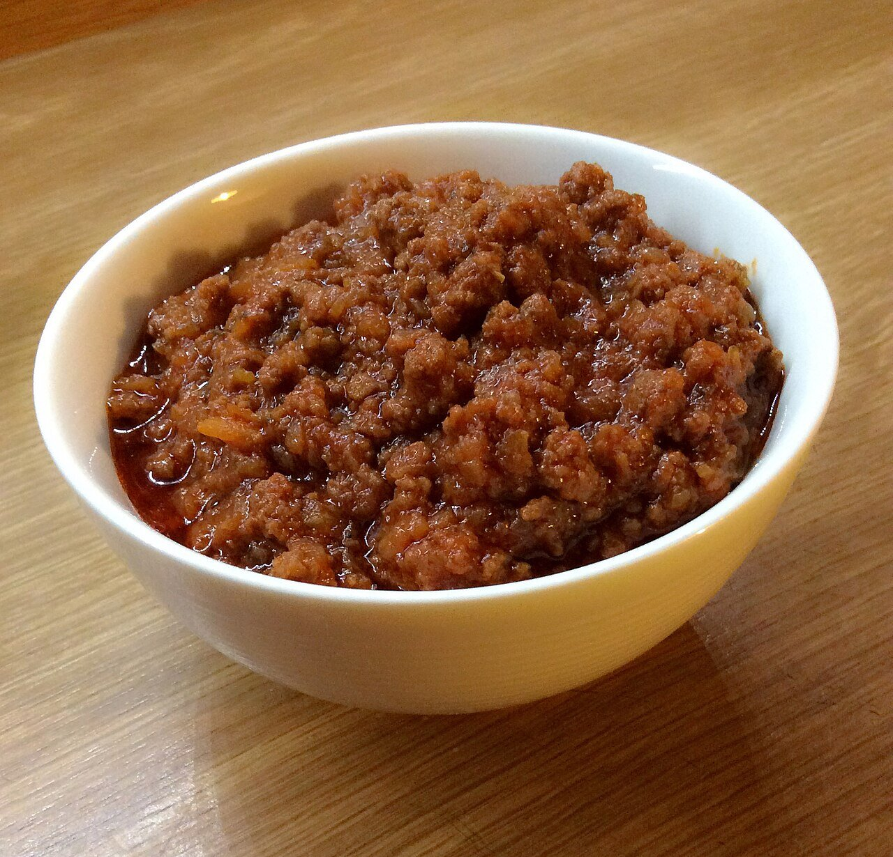

# Bolognese meat sauce

*Photo: [Erikatrioschi](https://commons.wikimedia.org/wiki/File:Ragu.jpg), [CC BY-SA 4.0](https://creativecommons.org/licenses/by-sa/4.0/), via Wikimedia Commons.*

Ground meat slowly braised with soffritto, wine, tomato and milk: the ragù of Bologna, more meat than tomato.

🥄 Serves **6** · ⏱️ 3 hours · Difficulty: medium

*En español:* [Ragú a la boloñesa (ragù alla bolognese)](ragu.es.md)

## Ingredients

- 10 oz ground beef
- 5 oz pancetta, finely chopped (or ground pork)
- 1 onion
- 1 carrot
- 1 celery stalk
- ⅔ cup dry white wine (or red)
- 2 tablespoons tomato paste
- ¾ cup crushed tomatoes
- ¾ cup plus 1 tablespoon whole milk
- 1¼ cups beef stock
- 3 tablespoons olive oil
- 1½ tablespoons butter
- Salt and pepper

## Directions

1. **Soffritto.** Finely chop the onion, carrot and celery and cook them in the oil and butter over low heat for 10 minutes.
2. **Meat.** Add the pancetta and beef and brown over medium heat, breaking it up, until the liquid evaporates and it starts to color.
3. **Wine.** Pour in the wine and let it cook off.
4. **Tomato.** Add the tomato paste dissolved in a little stock, the crushed tomatoes and salt.
5. **Braise.** Simmer, covered, over very low heat for 2–3 hours, adding stock as needed. Add the milk in the last half hour.

## Tips

- **Serve with** fresh tagliatelle or in lasagna; in Bologna it isn't served with spaghetti.
- **Better the next day.** It freezes very well.
- **The milk** softens the tomato's acidity and makes the meat more tender.
