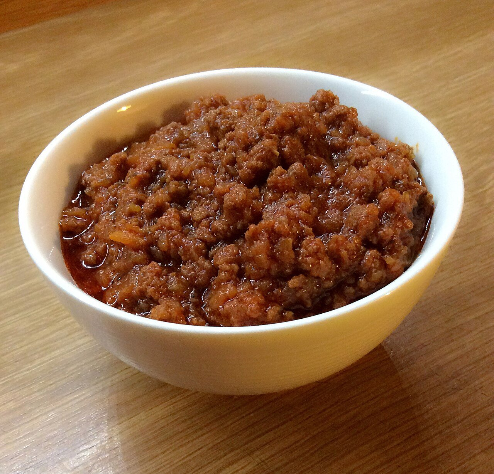

# Ragú a la boloñesa (ragù alla bolognese)

*Foto: [Erikatrioschi](https://commons.wikimedia.org/wiki/File:Ragu.jpg), [CC BY-SA 4.0](https://creativecommons.org/licenses/by-sa/4.0/deed.es), vía Wikimedia Commons.*

Carne picada guisada muy despacio con sofrito, vino, tomate y leche: el ragú de Bolonia, más carne que tomate.

🥄 Para **6 personas** · ⏱️ 3 horas · Dificultad: media

*In English:* [Bolognese meat sauce](ragu.en.md)

## Ingredientes

- 300 g de carne picada de ternera
- 150 g de panceta picada (o carne de cerdo)
- 1 cebolla
- 1 zanahoria
- 1 rama de apio
- 150 ml de vino blanco seco (o tinto)
- 2 cucharadas de tomate concentrado
- 200 g de tomate triturado
- 200 ml de leche entera
- 300 ml de caldo de carne
- 3 cucharadas de aceite de oliva
- 20 g de mantequilla
- Sal y pimienta

## Preparación

1. **El sofrito.** Pica muy fino la cebolla, la zanahoria y el apio y póchalos en el aceite y la mantequilla a fuego suave 10 minutos.
2. **La carne.** Añade la panceta y la carne y dórala a fuego medio, deshaciéndola, hasta que pierda el agua y empiece a tostarse.
3. **El vino.** Moja con el vino y deja que se evapore.
4. **El tomate.** Añade el concentrado disuelto en un poco de caldo, el tomate y sal.
5. **Guisar.** Cuece tapado a fuego muy suave 2–3 horas, añadiendo caldo cuando haga falta. Añade la leche en la última media hora.

## Consejos

- **Con** tagliatelle frescas o en lasaña; en Bolonia no se sirve con espaguetis.
- **Mejor de un día para otro.** Se congela muy bien.
- **La leche** suaviza la acidez del tomate y hace la carne más tierna.
