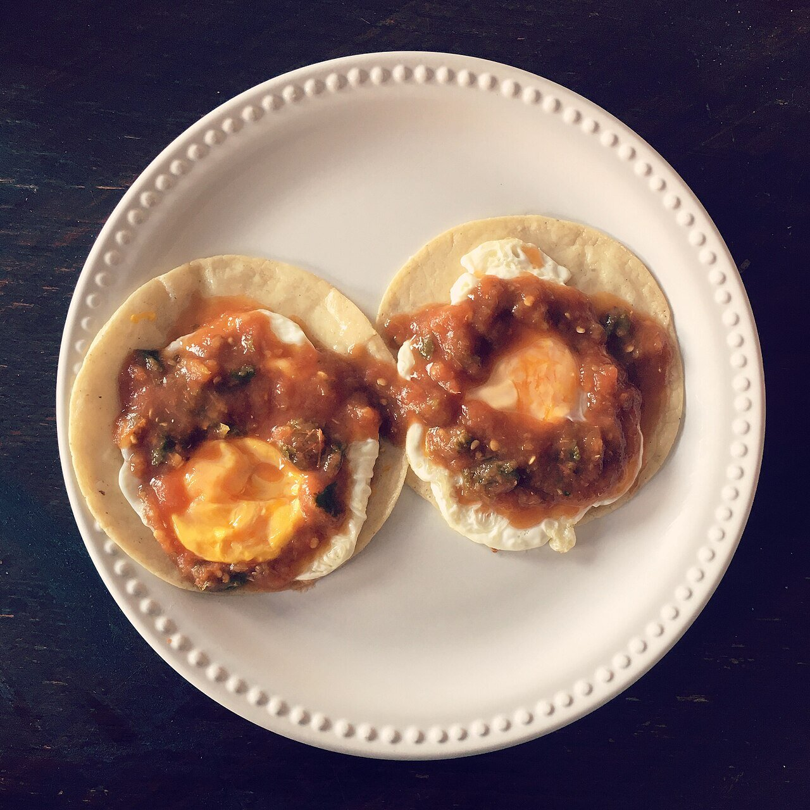

# Ranchero sauce

*Photo: [1000b](https://commons.wikimedia.org/wiki/File:Huevos_rancheros.jpg), [CC BY-SA 4.0](https://creativecommons.org/licenses/by-sa/4.0/), via Wikimedia Commons.*

Tomato, onion and garlic charred on a griddle, blended and fried: the red sauce for huevos rancheros, mild if the chile is seeded.

🥄 Serves **4** · ⏱️ 25 minutes · Difficulty: easy · Heat: mild

*En español:* [Salsa ranchera](ranchera.es.md)

## Ingredients

- 4 ripe tomatoes
- ½ white onion
- 2 garlic cloves, unpeeled
- ½ jalapeño, seeded (optional)
- 1 pinch oregano
- 1 handful cilantro
- 2 tablespoons oil
- Salt

## Directions

1. **Char.** Char the tomatoes, onion, garlic and chile on a comal or dry skillet, turning, until blistered and soft, about 10 minutes. Peel the garlic.
2. **Blend.** Blend everything with the oregano and a pinch of salt, leaving some texture.
3. **Fry.** Heat the oil in a skillet, pour in the sauce (it will spatter) and cook 8–10 minutes over medium heat until thickened and darker.
4. **Finish.** Season with salt and add the chopped cilantro.

## Tips

- **Huevos rancheros:** fried corn tortillas, fried eggs on top and the hot sauce over them.
- **Also with** beans, enchiladas, tacos or rice.
- **No heat:** leave out the chile.
