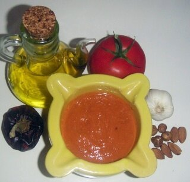

# Catalan roasted pepper and nut sauce

*Photo: [Slastic](https://commons.wikimedia.org/wiki/File:Romesco_i_ingredients.jpg), public domain, via Wikimedia Commons.*

The sauce from Tarragona: dried ñora peppers, roasted tomato and garlic, almonds, hazelnuts, bread, olive oil and vinegar.

🥄 Serves **6** · ⏱️ 45 minutes · Difficulty: medium

*En español:* [Salsa romesco](romesco.es.md)

## Ingredients

- 2 dried ñora peppers (or dried ancho chiles)
- 2 ripe tomatoes
- 1 head garlic
- ¼ cup toasted almonds
- ¼ cup toasted hazelnuts
- 1 slice fried bread
- Scant ½ cup olive oil
- 2 tablespoons wine vinegar
- Salt

## Directions

1. **Dried peppers.** Seed and soak them in hot water for 30 minutes. Scrape out the flesh.
2. **Roast.** Roast the tomatoes and the garlic head at 400 °F for 25–30 minutes. Peel them.
3. **Blend.** Blend the nuts with the bread, pepper flesh, roasted tomato and garlic.
4. **Emulsify.** Stream in the oil, then add the vinegar and salt, until thick but not pasty.

## Tips

- **Serve with** grilled spring onions (calçots), grilled vegetables and meats, fish or shellfish.
- **More rustic** if made in a mortar.
- **Better after resting** a few hours in the fridge.
