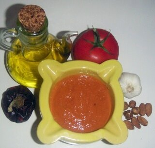

# Salsa romesco

*Foto: [Slastic](https://commons.wikimedia.org/wiki/File:Romesco_i_ingredients.jpg), dominio público, vía Wikimedia Commons.*

La salsa de Tarragona: ñoras, tomate y ajo asados, almendras, avellanas, pan, aceite y vinagre.

🥄 Para **6 personas** · ⏱️ 45 minutos · Dificultad: media

*In English:* [Catalan roasted pepper and nut sauce](romesco.en.md)

## Ingredientes

- 2 ñoras
- 2 tomates maduros
- 1 cabeza de ajos
- 30 g de almendras tostadas
- 30 g de avellanas tostadas
- 1 rebanada de pan frito
- 100 ml de aceite de oliva
- 2 cucharadas de vinagre de vino
- Sal

## Preparación

1. **Las ñoras.** Quítales las semillas y remójalas 30 minutos en agua caliente. Raspa la carne.
2. **Asar.** Asa los tomates y la cabeza de ajos en el horno a 200 °C unos 25–30 minutos. Pélalos.
3. **Triturar.** Tritura los frutos secos con el pan, la carne de ñora, el tomate y los ajos asados.
4. **Ligar.** Añade el aceite en un hilo y luego el vinagre y la sal, hasta tener una salsa espesa pero no pastosa.

## Consejos

- **Con calçots,** verduras y carnes a la brasa, pescado o marisco.
- **Más rústica** si la haces en el mortero.
- **Mejora reposada** unas horas en la nevera.
