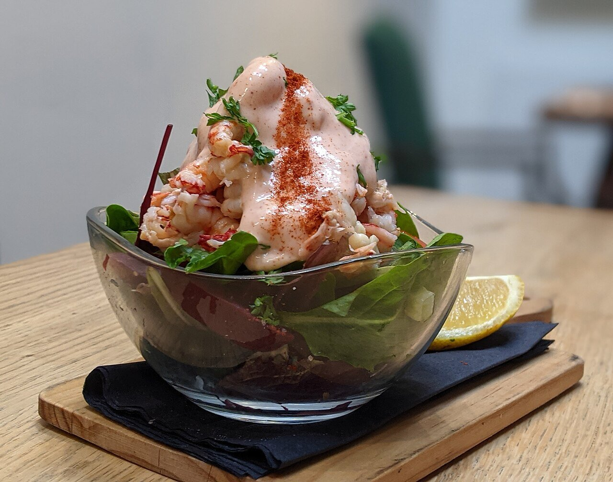

# Spanish cocktail sauce

*Photo: [Naturenet](https://commons.wikimedia.org/wiki/File:Crayfish_cocktail_with_Marie_Rose_sauce.jpg), [CC BY-SA 4.0](https://creativecommons.org/licenses/by-sa/4.0/), via Wikimedia Commons.*

Mayonnaise, ketchup, orange juice and a splash of brandy: the sauce for Spanish shrimp cocktail and avocado with shrimp.

🥄 Makes **about 1¼ cups** · ⏱️ 10 minutes · Difficulty: easy

*En español:* [Salsa rosa](rosa.es.md)

## Ingredients

- 1 cup mayonnaise (homemade or store-bought)
- 3 tablespoons ketchup or Spanish tomato sauce
- 2 tablespoons orange juice
- 1 tablespoon Spanish brandy
- A few drops Worcestershire sauce (optional)
- A few drops hot sauce (optional)
- Salt

## Directions

1. **Base.** Put the mayonnaise in a bowl.
2. **Color.** Whisk in the ketchup until evenly pink.
3. **Flavor.** Add the orange juice, brandy and, if you like, the Worcestershire and hot sauce.
4. **Taste.** Adjust salt and brandy and chill at least 30 minutes before serving.

## Tips

- **Shrimp cocktail:** shredded lettuce, cooked peeled shrimp and the sauce on top, served in a glass.
- **Also with** avocado, imitation crab, prawns or fries.
- **With homemade mayonnaise,** use it within 24 hours and keep it refrigerated.
