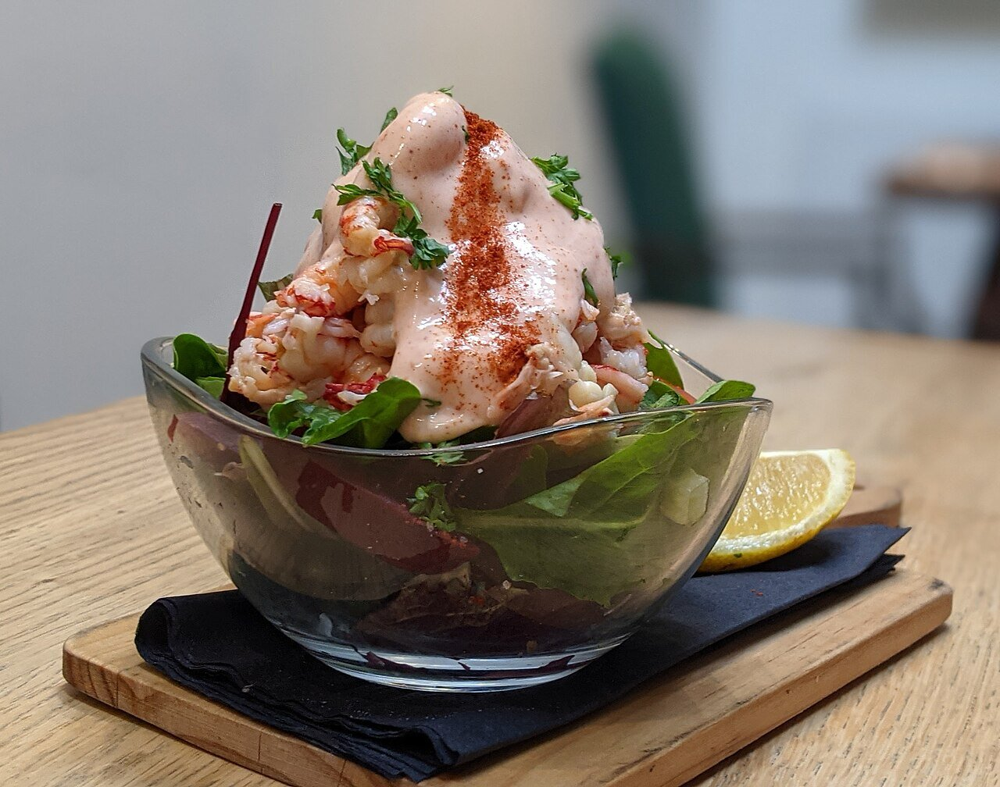

# Salsa rosa

*Foto: [Naturenet](https://commons.wikimedia.org/wiki/File:Crayfish_cocktail_with_Marie_Rose_sauce.jpg), [CC BY-SA 4.0](https://creativecommons.org/licenses/by-sa/4.0/deed.es), vía Wikimedia Commons.*

Mahonesa, kétchup, zumo de naranja y un chorrito de brandy: la salsa del cóctel de gambas y de los aguacates con gambas.

🥄 Para **unos 300 ml** · ⏱️ 10 minutos · Dificultad: fácil

*In English:* [Spanish cocktail sauce](rosa.en.md)

## Ingredientes

- 250 ml de mahonesa (casera o comprada)
- 3 cucharadas de kétchup o de tomate frito
- 2 cucharadas de zumo de naranja
- 1 cucharada de brandy de Jerez
- Unas gotas de salsa Worcestershire (opcional)
- Unas gotas de tabasco (opcional)
- Sal

## Preparación

1. **La base.** Pon la mahonesa en un bol.
2. **El color.** Añade el kétchup y mezcla con unas varillas hasta que quede de un rosa uniforme.
3. **El sabor.** Añade el zumo de naranja, el brandy y, si quieres, la salsa Worcestershire y el tabasco.
4. **Probar.** Ajusta de sal y de brandy y guárdala en la nevera al menos 30 minutos antes de servir.

## Consejos

- **Cóctel de gambas:** lechuga en juliana, gambas cocidas y peladas, y la salsa por encima, en copa.
- **También con** aguacate, palitos de cangrejo, langostinos o patatas fritas.
- **Con mahonesa casera,** gástala en 24 horas y guárdala siempre en la nevera.
