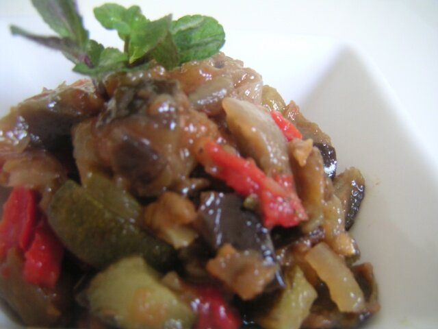

# Catalan summer vegetable stew

*Photo: [Slastic](https://commons.wikimedia.org/wiki/File:Samfaina.jpg), public domain, via Wikimedia Commons.*

Summer vegetables slowly stewed in olive oil: the Catalan sauce and side for salt cod and chicken.

🥄 Serves **4** · ⏱️ 1 hour · Difficulty: easy

*En español:* [Samfaina](samfaina.es.md)

## Ingredients

- 1 eggplant
- 1 zucchini
- 1 onion
- 1 red bell pepper
- 1 green bell pepper
- 3 ripe tomatoes
- 2 garlic cloves
- 6 tablespoons olive oil
- Salt

## Directions

1. **Cut.** Dice all the vegetables into ½-inch cubes. Grate the tomatoes, discarding the skins.
2. **Base.** Gently cook the onion and garlic for 10 minutes.
3. **Peppers.** Add the peppers and cook 10 more minutes.
4. **Eggplant and zucchini.** Add them with salt and cook 15 minutes.
5. **Tomato.** Stir in the tomato and simmer gently for 20 minutes, until the liquid evaporates.

## Tips

- **Serve with** salt cod, chicken, rabbit or fried eggs.
- **Hot or cold,** it's good either way.
- **Be patient:** low heat is the secret.
