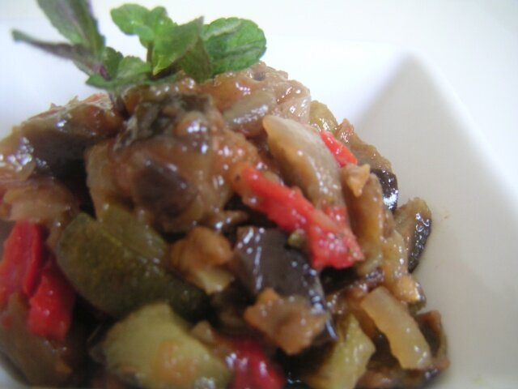

# Samfaina

*Foto: [Slastic](https://commons.wikimedia.org/wiki/File:Samfaina.jpg), dominio público, vía Wikimedia Commons.*

Verduras de verano guisadas despacio en aceite de oliva: la salsa-guarnición catalana del bacalao y el pollo.

🥄 Para **4 personas** · ⏱️ 1 hora · Dificultad: fácil

*In English:* [Catalan summer vegetable stew](samfaina.en.md)

## Ingredientes

- 1 berenjena
- 1 calabacín
- 1 cebolla
- 1 pimiento rojo
- 1 pimiento verde
- 3 tomates maduros
- 2 dientes de ajo
- 6 cucharadas de aceite de oliva
- Sal

## Preparación

1. **Cortar.** Corta todas las verduras en dados de 1 cm. Pela y ralla los tomates.
2. **La base.** Pocha la cebolla y el ajo a fuego suave 10 minutos.
3. **Los pimientos.** Añade los pimientos y cuece 10 minutos más.
4. **Berenjena y calabacín.** Añade la berenjena y el calabacín con sal y cuece 15 minutos.
5. **El tomate.** Incorpora el tomate y deja guisar 20 minutos a fuego suave, hasta que el agua se evapore.

## Consejos

- **Con** bacalao, pollo, conejo o huevos fritos.
- **Fría o caliente,** está buena de las dos formas.
- **Paciencia:** el secreto es el fuego lento.
