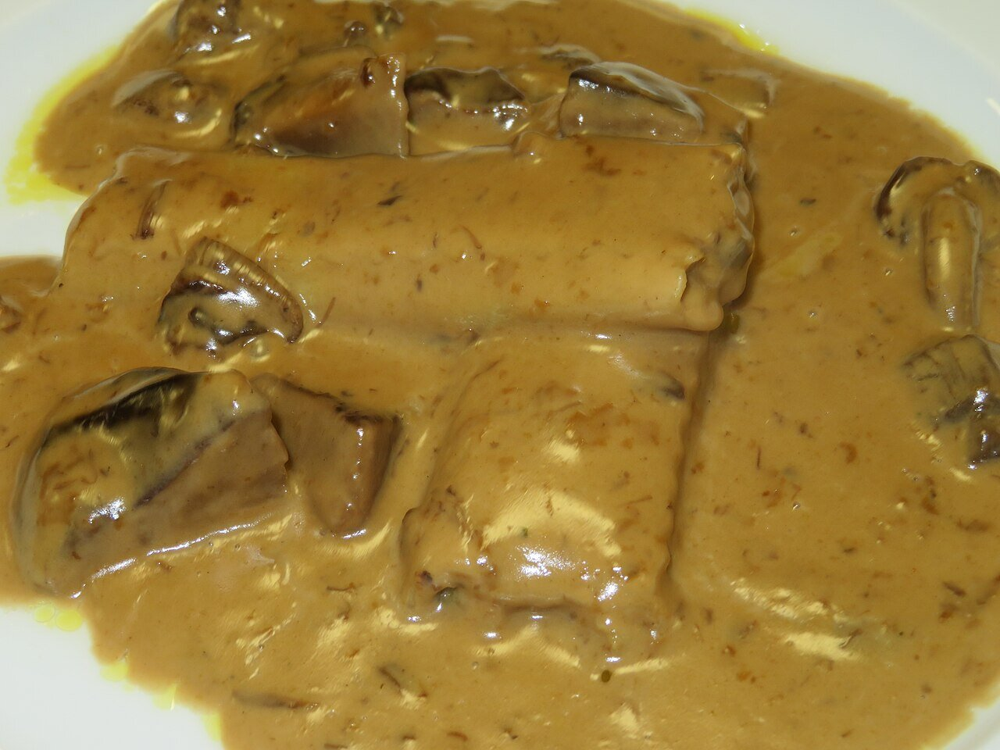

# Vegan mushroom cream sauce

*Photo: [Juan Emilio Prades Bel](https://commons.wikimedia.org/wiki/File:Canelones_de_setas_con_salsa_de_setas_(Espa%C3%B1a).jpg), [CC BY 4.0](https://creativecommons.org/licenses/by/4.0/), via Wikimedia Commons.*

Mushrooms sautéed with onion, garlic and thyme, thickened with oat milk: no cream, no wine and no peppers. The photo shows the sauce over cannelloni.

🥄 Serves **4** · ⏱️ 25 minutes · Difficulty: easy

*En español:* [Salsa de setas vegana](setas.es.md)

## Ingredients

- 14 oz mixed wild mushrooms or button mushrooms
- 1 onion
- 2 garlic cloves
- 1 tablespoon all-purpose flour
- 1¼ cups unsweetened oat milk
- Scant ½ cup vegetable stock
- 1 thyme sprig
- 1 pinch nutmeg
- 1 tablespoon chopped parsley
- 4 tablespoons olive oil
- Salt

## Directions

1. **Soften.** Gently cook the chopped onion and garlic in the oil for about 8 minutes.
2. **Mushrooms.** Raise the heat, add the chopped mushrooms and thyme and sauté until their liquid evaporates and they brown.
3. **Flour.** Stir in the flour for 1 minute.
4. **Thicken.** Gradually stir in the stock and oat milk and simmer 5–8 minutes until thickened.
5. **Finish.** Add the nutmeg, parsley and salt. Blend half of it for a creamier sauce.

## Tips

- **Serve with** pasta, rice, potatoes, tofu, seitan or vegetable cannelloni.
- **More flavor:** add a handful of soaked dried mushrooms and use their water instead of the stock.
- **Gluten-free:** thicken with 1 teaspoon cornstarch instead of flour.
