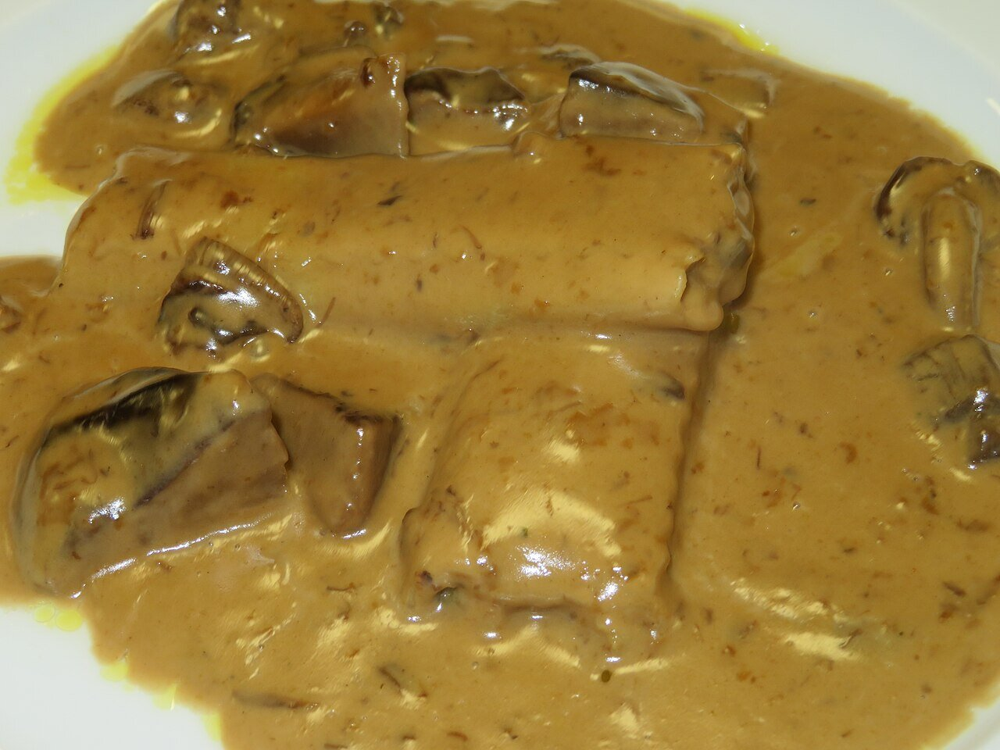

# Salsa de setas vegana

*Foto: [Juan Emilio Prades Bel](https://commons.wikimedia.org/wiki/File:Canelones_de_setas_con_salsa_de_setas_(Espa%C3%B1a).jpg), [CC BY 4.0](https://creativecommons.org/licenses/by/4.0/deed.es), vía Wikimedia Commons.*

Setas salteadas con cebolla, ajo y tomillo, ligadas con bebida de avena: sin nata, sin vino y sin pimiento. En la foto, la salsa va sobre unos canelones.

🥄 Para **4 personas** · ⏱️ 25 minutos · Dificultad: fácil

*In English:* [Vegan mushroom cream sauce](setas.en.md)

## Ingredientes

- 400 g de setas variadas o champiñones
- 1 cebolla
- 2 dientes de ajo
- 1 cucharada de harina
- 300 ml de bebida de avena sin azúcar
- 100 ml de caldo de verduras
- 1 ramita de tomillo
- 1 pizca de nuez moscada
- 1 cucharada de perejil picado
- 4 cucharadas de aceite de oliva
- Sal

## Preparación

1. **Pochar.** Pocha la cebolla y el ajo picados en el aceite a fuego suave unos 8 minutos.
2. **Las setas.** Sube el fuego, añade las setas troceadas y el tomillo y saltéalas hasta que suelten el agua y se doren.
3. **La harina.** Añade la harina y remueve 1 minuto.
4. **Ligar.** Añade el caldo y la bebida de avena poco a poco, removiendo, y cuece 5–8 minutos a fuego suave hasta que espese.
5. **Terminar.** Añade la nuez moscada, el perejil y la sal. Tritura la mitad si la quieres más cremosa.

## Consejos

- **Con** pasta, arroz, patatas, tofu, seitán o canelones de verduras.
- **Más sabor:** añade un puñado de setas secas remojadas y su agua en lugar del caldo.
- **Sin gluten:** espesa con 1 cucharadita de maicena en vez de harina.
