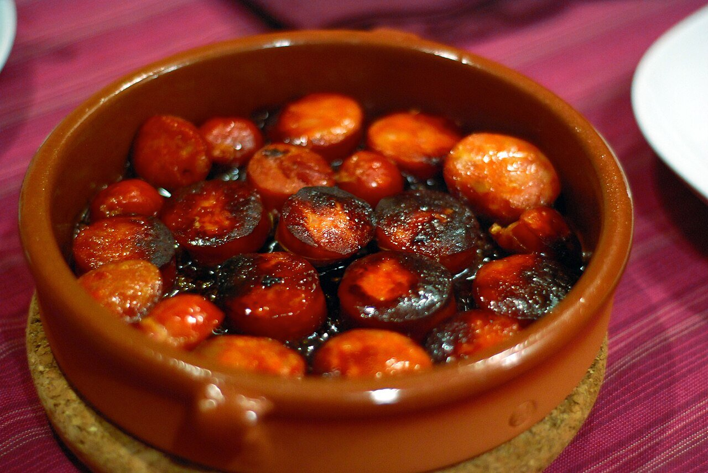

# Asturian cider sauce

*Photo: [Lu from Seattle, USA](https://commons.wikimedia.org/wiki/File:Chorizo_a_la_sidra.jpg), [CC BY 2.0](https://creativecommons.org/licenses/by/2.0/), via Wikimedia Commons.*

Natural Asturian cider reduced with onion and bay leaf: the sauce for chorizo in cider, and also for hake or pork loin in cider.

🥄 Serves **4** · ⏱️ 30 minutes · Difficulty: easy

*En español:* [Salsa a la sidra](sidra.es.md)

## Ingredients

- 1 onion
- 1 garlic clove
- 2 cups natural (still, dry) hard cider
- 1 bay leaf
- 1 tart apple (optional)
- 1 teaspoon all-purpose flour (optional, for fish or pork)
- 3 tablespoons olive oil
- Salt and pepper

## Directions

1. **Base.** Gently cook the chopped onion and garlic in the oil for about 10 minutes. If using the apple, add it peeled and diced for the last 5 minutes.
2. **Flour.** For fish or pork, stir in the flour for 1 minute. Skip it for chorizo: its fat thickens the sauce.
3. **Cider.** Add the cider and bay leaf, raise the heat and reduce by half, about 15 minutes.
4. **Finish.** Season with salt and pepper. Blend it for a smooth sauce.

## Tips

- **Chorizo in cider:** prick 4–6 semi-cured Spanish chorizos and simmer them whole in the cider for 20–25 minutes, until the sauce turns red. Slice to serve.
- **Hake in cider:** simmer the fillets in the sauce for 5–6 minutes, with a few clams.
- **Use still, dry cider,** not sparkling or sweet.
