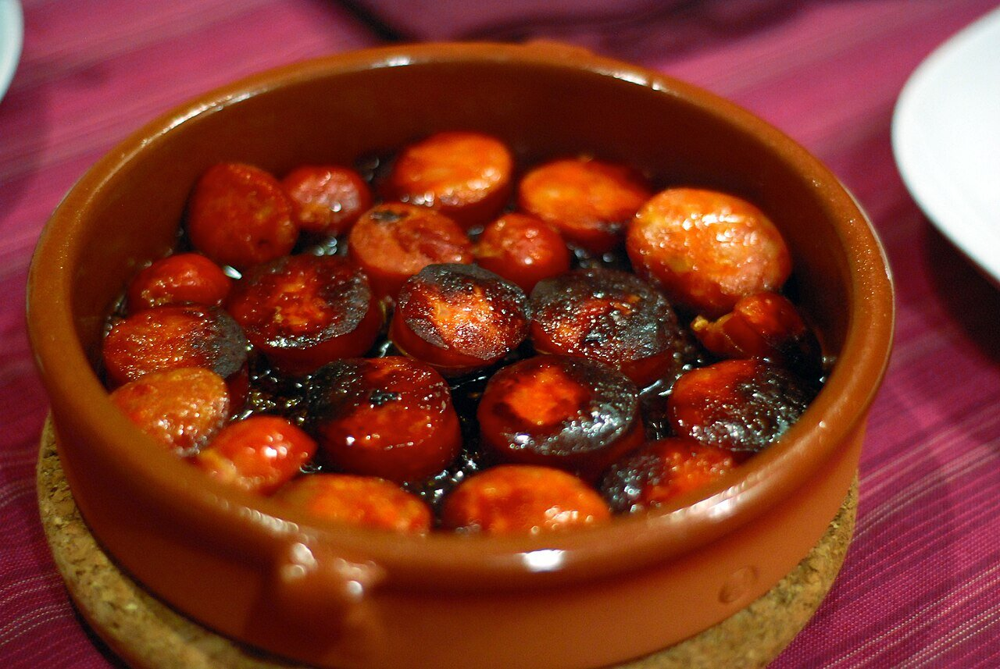

# Salsa a la sidra

*Foto: [Lu from Seattle, USA](https://commons.wikimedia.org/wiki/File:Chorizo_a_la_sidra.jpg), [CC BY 2.0](https://creativecommons.org/licenses/by/2.0/deed.es), vía Wikimedia Commons.*

Sidra natural asturiana reducida con cebolla y laurel: la salsa del chorizo a la sidra, y también de la merluza y el lomo a la sidra.

🥄 Para **4 personas** · ⏱️ 30 minutos · Dificultad: fácil

*In English:* [Asturian cider sauce](sidra.en.md)

## Ingredientes

- 1 cebolla
- 1 diente de ajo
- 500 ml de sidra natural asturiana
- 1 hoja de laurel
- 1 manzana ácida (opcional)
- 1 cucharadita de harina (opcional, para pescado o lomo)
- 3 cucharadas de aceite de oliva
- Sal y pimienta

## Preparación

1. **El sofrito.** Pocha la cebolla y el ajo picados en el aceite a fuego suave unos 10 minutos. Si usas manzana, añádela pelada y en dados los últimos 5 minutos.
2. **La harina.** Para pescado o lomo, añade la harina y remueve 1 minuto. Para chorizo no hace falta: su grasa espesa la salsa.
3. **La sidra.** Añade la sidra y el laurel, sube el fuego y deja reducir a la mitad, unos 15 minutos.
4. **Terminar.** Ajusta de sal y pimienta. Tritúrala si quieres una salsa fina.

## Consejos

- **Chorizo a la sidra:** pincha 4–6 chorizos asturianos semicurados y cuécelos enteros en la sidra 20–25 minutos, a fuego suave, hasta que la salsa se tiña de rojo. Córtalos en rodajas para servir.
- **Merluza a la sidra:** cuece los lomos 5–6 minutos en la salsa, con unas almejas.
- **Sidra natural,** no espumosa ni dulce.
