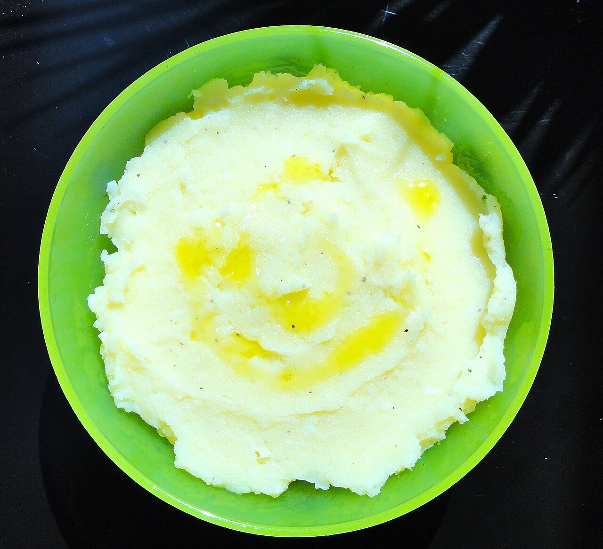

# Skordalia

*Photo: [Amymoni](https://commons.wikimedia.org/wiki/File:Skordalia.jpg), [CC BY-SA 3.0](https://creativecommons.org/licenses/by-sa/3.0/), via Wikimedia Commons.*

Mashed potato with plenty of garlic, olive oil and vinegar: the Greek sauce for fried salt cod, beets and vegetables.

🥄 Serves **4** · ⏱️ 30 minutes · Difficulty: easy

*En español:* [Skordaliá](skordalia.es.md)

## Ingredients

- 1 lb starchy potatoes (russet)
- 4 garlic cloves
- 7 tablespoons extra-virgin olive oil
- 2 tablespoons white wine vinegar or lemon juice
- ½ cup ground almonds or walnuts (optional)
- Salt

## Directions

1. **Potatoes.** Boil them in their skins in salted water 20 to 25 minutes, until tender. Peel while hot.
2. **Garlic.** Pound the garlic in a mortar with a pinch of salt to a paste.
3. **Mash.** Mash the hot potatoes with a ricer or fork and mix in the garlic and the nuts, if using.
4. **Oil.** Add the oil in a thin stream and the vinegar a spoonful at a time, alternating and stirring, until creamy.
5. **Serve.** Taste for salt and garlic. Serve warm or cold.

## Tips

- **No blender:** it makes potatoes gluey; use a ricer or fork.
- **With bread:** the island version uses soaked stale bread instead of potato.
- **If it thickens as it cools,** loosen it with a little of the potato water.
