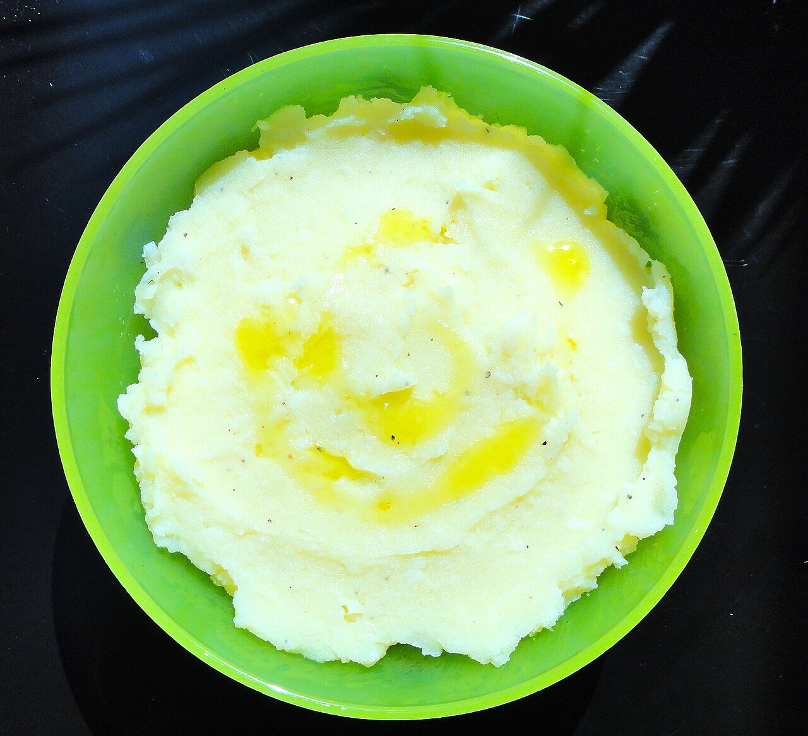

# Skordaliá

*Foto: [Amymoni](https://commons.wikimedia.org/wiki/File:Skordalia.jpg), [CC BY-SA 3.0](https://creativecommons.org/licenses/by-sa/3.0/deed.es), vía Wikimedia Commons.*

Puré de patata con mucho ajo, aceite de oliva y vinagre: la salsa griega del bacalao frito, la remolacha y las verduras.

🥄 Para **4 personas** · ⏱️ 30 minutos · Dificultad: fácil

*In English:* [Skordalia](skordalia.en.md)

## Ingredientes

- 500 g de patatas harinosas
- 4 dientes de ajo
- 100 ml de aceite de oliva virgen extra
- 2 cucharadas de vinagre de vino blanco o zumo de limón
- 50 g de almendras o nueces molidas (opcional)
- Sal

## Preparación

1. **Las patatas.** Cuécelas con piel en agua con sal 20-25 minutos, hasta que estén tiernas. Pélalas en caliente.
2. **El ajo.** Machaca los ajos en un mortero con una pizca de sal hasta hacer una pasta.
3. **Machacar.** Aplasta las patatas calientes con un pasapurés o un tenedor y mezcla con el ajo y, si las usas, las almendras.
4. **El aceite.** Añade el aceite en hilo y el vinagre a cucharadas, alternando y removiendo, hasta que quede un puré cremoso.
5. **Servir.** Prueba de sal y de ajo. Sírvela templada o fría.

## Consejos

- **Nada de batidora:** con la patata la deja chiclosa; usa pasapurés o tenedor.
- **Con pan:** la versión de las islas se hace con pan duro remojado en vez de patata.
- **Si espesa al enfriar,** aligérala con un poco de agua de cocer las patatas.
