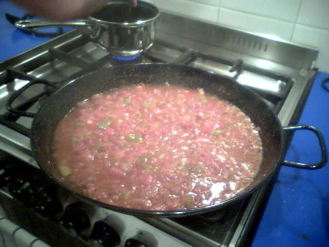

# Spanish sofrito

*Photo: [donandcarol](https://commons.wikimedia.org/wiki/File:Sofrito_for_paella.jpg), [CC BY 2.0](https://creativecommons.org/licenses/by/2.0/), via Wikimedia Commons.*

Onion, pepper, garlic and tomato slowly cooked in olive oil: the base for rice dishes, stews and beans.

🥄 Makes **about 1½ cups** · ⏱️ 45 minutes · Difficulty: easy

*En español:* [Sofrito](sofrito.es.md)

## Ingredients

- 2 onions
- 1 green bell pepper
- 2 garlic cloves
- 3 ripe tomatoes (or 1 can, 14 oz, crushed tomatoes)
- 6 tablespoons olive oil
- 1 pinch sugar
- Salt

## Directions

1. **Chop.** Finely chop the onion, pepper and garlic. Grate the tomatoes, discarding the skins.
2. **Soften.** Cook the onion and pepper with a pinch of salt over low heat for 15–20 minutes, until soft and golden.
3. **Garlic.** Add the garlic and cook 1 minute.
4. **Tomato.** Add the tomato and sugar and cook 20 more minutes, until the oil separates and the sofrito is dark and jammy.

## Tips

- **For paella and rice dishes,** stir in paprika at the end, off the heat, right before the stock.
- **Make extra:** it freezes in portions.
- **Don't rush it:** good sofrito never sees high heat.
