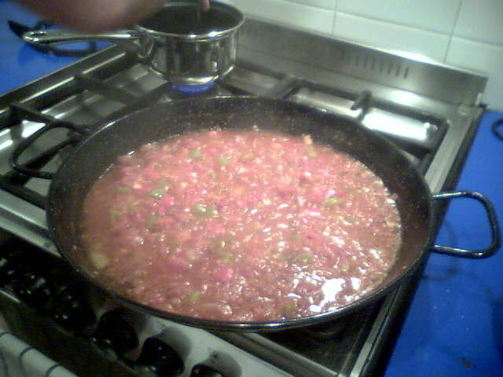

# Sofrito

*Foto: [donandcarol](https://commons.wikimedia.org/wiki/File:Sofrito_for_paella.jpg), [CC BY 2.0](https://creativecommons.org/licenses/by/2.0/deed.es), vía Wikimedia Commons.*

Cebolla, pimiento, ajo y tomate cocinados despacio en aceite de oliva: la base de arroces, guisos y legumbres.

🥄 Para **unos 400 g** · ⏱️ 45 minutos · Dificultad: fácil

*In English:* [Spanish sofrito](sofrito.en.md)

## Ingredientes

- 2 cebollas
- 1 pimiento verde
- 2 dientes de ajo
- 3 tomates maduros (o 400 g de tomate triturado)
- 6 cucharadas de aceite de oliva
- 1 pizca de azúcar
- Sal

## Preparación

1. **Picar.** Pica la cebolla, el pimiento y el ajo muy finos. Ralla los tomates.
2. **Pochar.** Cocina la cebolla y el pimiento con una pizca de sal a fuego suave 15–20 minutos, hasta que estén blandos y dorados.
3. **El ajo.** Añade el ajo y cocina 1 minuto.
4. **El tomate.** Añade el tomate y el azúcar y cocina 20 minutos más, hasta que el aceite se separe y el sofrito quede oscuro y concentrado.

## Consejos

- **Para paella o arroces,** añade pimentón al final, fuera del fuego, justo antes del caldo.
- **Haz de más:** se congela en porciones.
- **Sin prisa:** un buen sofrito no se hace a fuego fuerte.
