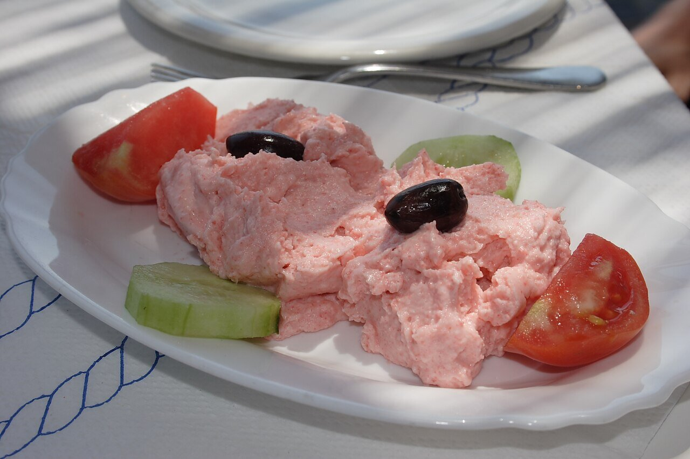

# Taramosalata

*Photo: [Robert Kindermann](https://commons.wikimedia.org/wiki/File:Taramosalata01.jpg), [CC BY-SA 2.5](https://creativecommons.org/licenses/by-sa/2.5/), via Wikimedia Commons.*

Cured fish roe (tarama) whipped with bread, onion, lemon and oil: a salty, pale pink spread for bread or raw vegetables.

🥄 Serves **4** · ⏱️ 15 minutes · Difficulty: easy

*En español:* [Taramosalata](taramosalata.es.md)

## Ingredients

- 3½ oz tarama (cured carp or cod roe)
- 4 slices day-old bread, crusts removed
- ½ small onion, grated
- Juice of 1 or 2 lemons
- ¾ cup oil (half mild olive oil, half sunflower)

## Directions

1. **Bread.** Soak it in water and squeeze it dry with your hands.
2. **Base.** Blend the tarama with the grated onion and bread to a smooth paste.
3. **Emulsify.** With the blender running, add the oil in a thin stream, alternating with the lemon juice, until fluffy like mayonnaise.
4. **Adjust.** Taste and add more lemon if needed. It rarely needs salt.
5. **Serve.** Chill for 1 hour and serve with bread, olives and raw vegetables.

## Tips

- **Color:** white tarama is traditional; bright pink usually means added coloring.
- **Milder:** replace some of the bread with boiled potato.
- **Where to buy it:** Greek or Turkish shops; smoked cod roe also works.
