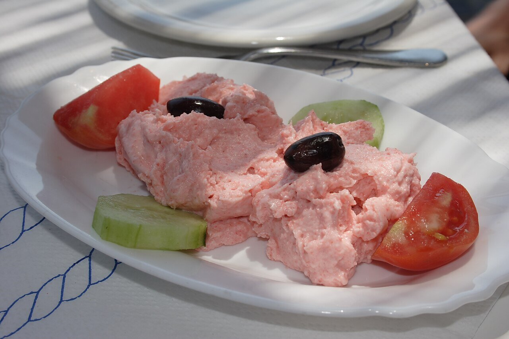

# Taramosalata

*Foto: [Robert Kindermann](https://commons.wikimedia.org/wiki/File:Taramosalata01.jpg), [CC BY-SA 2.5](https://creativecommons.org/licenses/by-sa/2.5/deed.es), vía Wikimedia Commons.*

Huevas de pescado curadas (tarama) batidas con pan, cebolla, limón y aceite: una crema salada de color rosado para mojar pan o acompañar verduras.

🥄 Para **4 personas** · ⏱️ 15 minutos · Dificultad: fácil

*In English:* [Taramosalata](taramosalata.en.md)

## Ingredientes

- 100 g de tarama (huevas de carpa o bacalao curadas)
- 4 rebanadas de pan del día anterior, sin corteza
- ½ cebolla pequeña rallada
- El zumo de 1 o 2 limones
- 200 ml de aceite (mitad de oliva suave y mitad de girasol)

## Preparación

1. **El pan.** Remójalo en agua y escúrrelo bien con las manos.
2. **La base.** Tritura la tarama con la cebolla rallada y el pan hasta que quede una pasta fina.
3. **Emulsionar.** Con la batidora en marcha, añade el aceite en hilo fino, alternando con el zumo de limón, hasta que quede una crema esponjosa, como una mayonesa.
4. **Ajustar.** Prueba y añade más limón si hace falta. No suele necesitar sal.
5. **Servir.** Refrigérala 1 hora y sírvela con pan, aceitunas y verduras crudas.

## Consejos

- **Color:** la tarama blanca es la tradicional; la rosa intensa suele llevar colorante.
- **Más suave:** sustituye parte del pan por patata cocida.
- **Dónde comprarla:** en tiendas griegas o turcas; las huevas de bacalao ahumadas también sirven.
