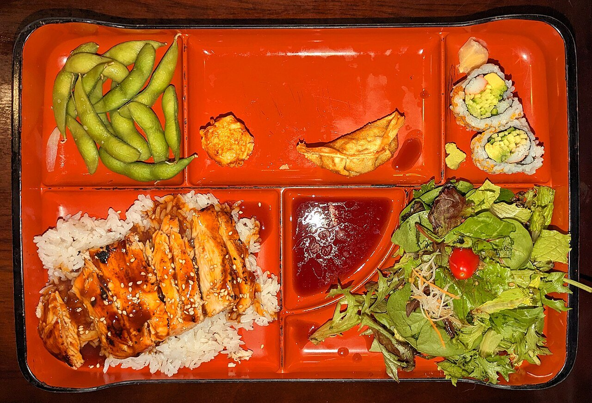

# Teriyaki sauce

*Photo: [Daderot](https://commons.wikimedia.org/wiki/File:Chicken_teriyaki_bento_box_-_Massachusetts.jpg), [CC0](https://creativecommons.org/publicdomain/zero/1.0/), via Wikimedia Commons.*

Soy sauce, mirin, sake and sugar reduced into a glaze: the sauce for chicken, salmon or tofu teriyaki, topped with toasted sesame.

🥄 Serves **4** · ⏱️ 10 minutes · Difficulty: easy

*En español:* [Salsa teriyaki](teriyaki.es.md)

## Ingredients

- 4 tablespoons soy sauce
- 4 tablespoons mirin
- 2 tablespoons sake
- 1½ tablespoons sugar
- 1 teaspoon grated ginger (optional)
- 1 teaspoon toasted sesame seeds, to serve

## Directions

1. **Mix.** Stir together the soy sauce, mirin, sake, sugar and ginger.
2. **Brown.** Brown the chicken (skin side down), salmon or tofu in a pan with a little oil and pour off the rendered fat.
3. **Glaze.** Pour the sauce into the pan and cook over medium heat, turning and basting, until thick and glossy, 3–5 minutes.
4. **Serve.** Slice, spoon over the remaining sauce and sprinkle with sesame.

## Tips

- **Serve with** white rice and steamed vegetables, or in a bento.
- **Alcohol-free:** replace the sake and mirin with water and 1 more tablespoon sugar or honey.
- **Thicker:** stir in ½ teaspoon cornstarch mixed with cold water at the end.
