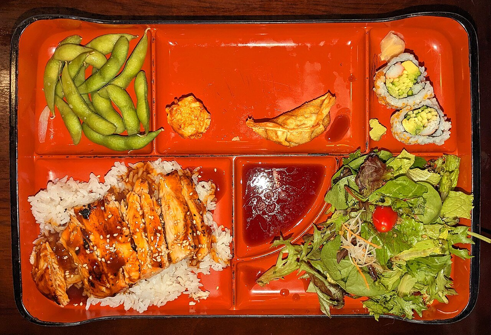

# Salsa teriyaki

*Foto: [Daderot](https://commons.wikimedia.org/wiki/File:Chicken_teriyaki_bento_box_-_Massachusetts.jpg), [CC0](https://creativecommons.org/publicdomain/zero/1.0/deed.es), vía Wikimedia Commons.*

Salsa de soja, mirin, sake y azúcar reducidos hasta glasear: la salsa del pollo, el salmón o el tofu teriyaki, con sésamo tostado por encima.

🥄 Para **4 personas** · ⏱️ 10 minutos · Dificultad: fácil

*In English:* [Teriyaki sauce](teriyaki.en.md)

## Ingredientes

- 4 cucharadas de salsa de soja
- 4 cucharadas de mirin
- 2 cucharadas de sake
- 1½ cucharadas de azúcar
- 1 cucharadita de jengibre rallado (opcional)
- 1 cucharadita de sésamo tostado, para servir

## Preparación

1. **Mezclar.** Mezcla la soja, el mirin, el sake, el azúcar y el jengibre.
2. **Dorar.** Dora el pollo (con la piel hacia abajo), el salmón o el tofu en una sartén con poco aceite y retira la grasa que suelte.
3. **Glasear.** Vierte la salsa en la sartén y cuece a fuego medio, dando la vuelta y bañando la pieza, hasta que la salsa espese y brille, 3–5 minutos.
4. **Servir.** Corta en tiras, riega con la salsa que quede y espolvorea el sésamo.

## Consejos

- **Con arroz blanco** y verduras al vapor, o en un bento.
- **Sin alcohol:** cambia el sake y el mirin por agua y 1 cucharada más de azúcar o de miel.
- **Más espesa:** añade ½ cucharadita de maicena disuelta en agua fría al final.
