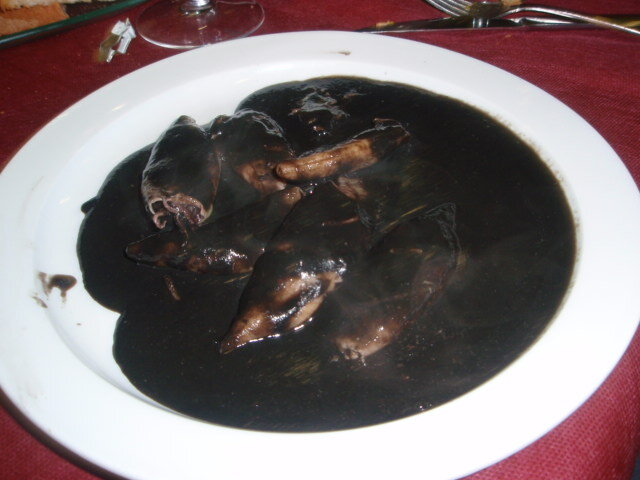

# Squid ink sauce

*Photo: [Mover el Bigote](https://commons.wikimedia.org/wiki/File:Zaragoza_-_Antiguo_Bar_La_Jota_-_Calamares_en_su_tinta.jpg), [CC BY 2.0](https://creativecommons.org/licenses/by/2.0/), via Wikimedia Commons.*

The black sauce for squid in its own ink: slowly cooked onion, wine, fish stock and squid ink.

🥄 Serves **4** · ⏱️ 50 minutes · Difficulty: medium

*En español:* [Salsa de tinta de calamar](tinta.es.md)

## Ingredients

- 2 onions
- 1 green bell pepper
- 2 garlic cloves
- 1 ripe tomato
- Scant ½ cup dry white wine
- ¾ cup plus 1 tablespoon fish stock
- 4 packets squid ink (or the ink sacs from the squid)
- 1 slice fried bread (optional)
- 4 tablespoons olive oil
- Salt

## Directions

1. **Base.** Gently cook the chopped onion, pepper and garlic for 20 minutes, until very soft.
2. **Tomato.** Add the grated tomato and cook 5 minutes.
3. **Wine.** Pour in the wine and let it reduce. Add the stock and the bread, if using.
4. **Ink.** Dissolve the ink in a little stock and stir it in. Simmer 10 minutes.
5. **Blend.** Blend and strain the sauce. Add the seared squid and simmer until tender.

## Tips

- **Enough for 2 lb** cleaned squid or baby squid.
- **Serve with white rice,** the classic way.
- **Careful with your clothes:** ink stains.
