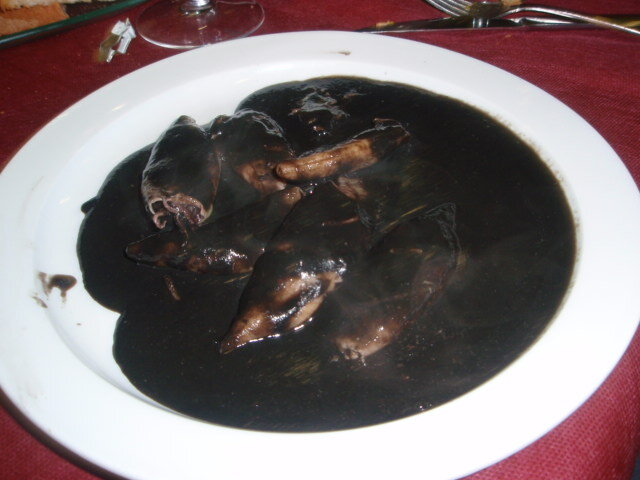

# Salsa de tinta de calamar

*Foto: [Mover el Bigote](https://commons.wikimedia.org/wiki/File:Zaragoza_-_Antiguo_Bar_La_Jota_-_Calamares_en_su_tinta.jpg), [CC BY 2.0](https://creativecommons.org/licenses/by/2.0/deed.es), vía Wikimedia Commons.*

La salsa negra de los calamares y chipirones en su tinta: cebolla pochada, vino, fumet y tinta.

🥄 Para **4 personas** · ⏱️ 50 minutos · Dificultad: media

*In English:* [Squid ink sauce](tinta.en.md)

## Ingredientes

- 2 cebollas
- 1 pimiento verde
- 2 dientes de ajo
- 1 tomate maduro
- 100 ml de vino blanco
- 200 ml de fumet de pescado
- 4 sobres de tinta de calamar (o las bolsas de tinta de los calamares)
- 1 rebanada de pan frito (opcional)
- 4 cucharadas de aceite de oliva
- Sal

## Preparación

1. **El sofrito.** Pocha la cebolla, el pimiento y el ajo picados a fuego suave 20 minutos, hasta que estén muy blandos.
2. **El tomate.** Añade el tomate rallado y cocina 5 minutos.
3. **El vino.** Moja con el vino y deja reducir. Añade el fumet y el pan, si lo usas.
4. **La tinta.** Disuelve la tinta en un poco de fumet y añádela. Cuece 10 minutos.
5. **Triturar.** Tritura y cuela la salsa. Mete los calamares ya marcados y guísalos en ella hasta que estén tiernos.

## Consejos

- **Para 1 kg** de calamares o chipirones limpios.
- **Con arroz blanco** es lo clásico.
- **Cuidado con la ropa:** la tinta mancha mucho.
