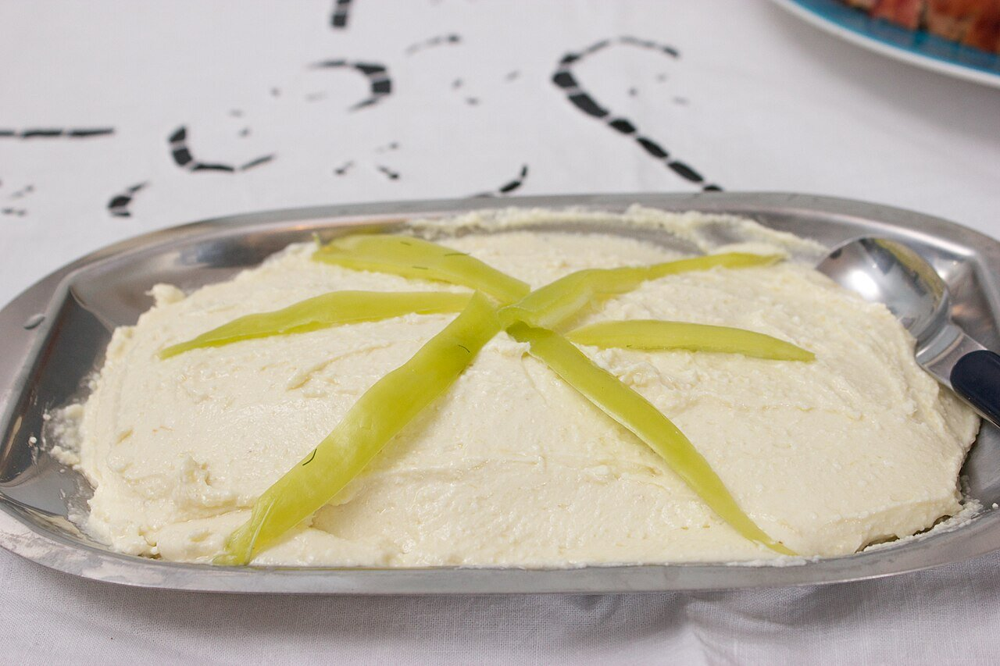

# Tirokafteri

*Photo: [Alexander Baxevanis](https://commons.wikimedia.org/wiki/File:Tirokafteri.jpg), [CC BY 2.0](https://creativecommons.org/licenses/by/2.0/), via Wikimedia Commons.*

Feta whipped with roasted red pepper, olive oil and a little chile: a slightly spicy cheese spread for bread, pita and grilled meat.

🥄 Serves **4** · ⏱️ 25 minutes · Difficulty: easy

*En español:* [Tirokafterí](tirokafteri.es.md)

## Ingredients

- 7 oz feta cheese
- 1 roasted red bell pepper, peeled (fresh or jarred)
- 1 small hot chile or ½ teaspoon hot paprika (to taste)
- 3 tablespoons Greek yogurt
- 3 tablespoons extra-virgin olive oil
- 1 teaspoon lemon juice or vinegar

## Directions

1. **Pepper.** If fresh, roast it at 425 °F for 25 minutes, let it steam covered and peel it. Remove the seeds.
2. **Blend.** Put the crumbled feta, pepper, chile, yogurt and lemon in a blender.
3. **Oil.** Blend while adding the oil a little at a time, until creamy but with some texture.
4. **Rest.** Taste, adjust the heat and chill for 30 minutes.
5. **Serve.** With a drizzle of oil on top, with toasted pita or next to lamb chops.

## Tips

- **Mild:** skip the chile and use only the roasted pepper.
- **Texture:** for a rustic spread, mash the feta with a fork instead of blending.
- **No yogurt:** it comes out denser and saltier, as in Thessaloniki.
