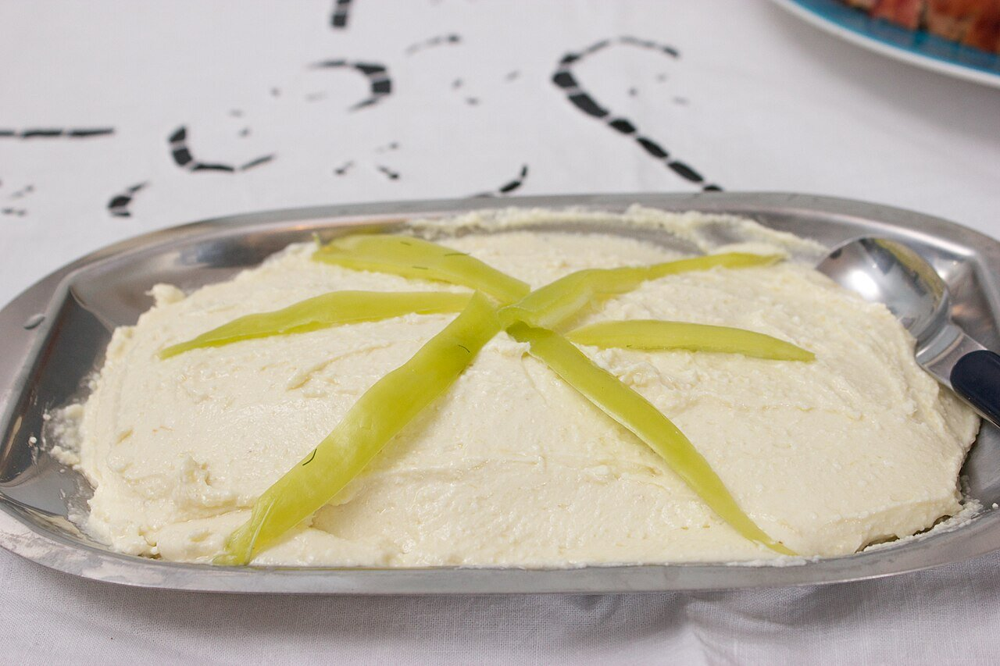

# Tirokafterí

*Foto: [Alexander Baxevanis](https://commons.wikimedia.org/wiki/File:Tirokafteri.jpg), [CC BY 2.0](https://creativecommons.org/licenses/by/2.0/deed.es), vía Wikimedia Commons.*

Feta batida con pimiento rojo asado, aceite de oliva y un toque de guindilla: una crema de queso que pica un poco, para pan, pita y carnes a la brasa.

🥄 Para **4 personas** · ⏱️ 25 minutos · Dificultad: fácil

*In English:* [Tirokafteri](tirokafteri.en.md)

## Ingredientes

- 200 g de queso feta
- 1 pimiento rojo asado y pelado (o de bote)
- 1 guindilla pequeña o ½ cucharadita de pimentón picante (al gusto)
- 3 cucharadas de yogur griego
- 3 cucharadas de aceite de oliva virgen extra
- 1 cucharadita de zumo de limón o vinagre

## Preparación

1. **El pimiento.** Si es fresco, ásalo a 220 °C 25 minutos, déjalo sudar tapado y pélalo. Quítale las semillas.
2. **Triturar.** Pon en la batidora la feta desmigada, el pimiento, la guindilla, el yogur y el limón.
3. **El aceite.** Tritura añadiendo el aceite poco a poco hasta que quede una crema con algo de textura.
4. **Reposar.** Pruébala, ajusta el picante y déjala en la nevera 30 minutos.
5. **Servir.** Con un hilo de aceite por encima, pan de pita tostado o junto a las chuletas.

## Consejos

- **Poco picante:** quita la guindilla y usa solo el pimiento asado.
- **Textura:** si la quieres más rústica, aplasta la feta con un tenedor en vez de triturarla.
- **Sin yogur:** queda más densa y salada, como en Tesalónica.
