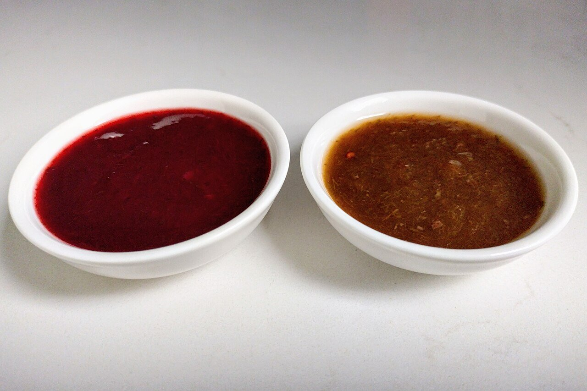

# Tkemali (Georgian plum sauce)

*Photo: [Jelger Groeneveld](https://commons.wikimedia.org/wiki/File:Red_and_brown_tkemali.jpg), [CC BY 2.0](https://creativecommons.org/licenses/by/2.0/), via Wikimedia Commons.*

Sour plums cooked and strained with garlic, cilantro, dill and mint: the Georgian sauce for skewers (mtsvadi), potatoes and chicken. The photo shows red and green tkemali.

🥄 Makes **1 jar** (about 1⅔ cups) · ⏱️ 45 minutes · Difficulty: easy

*En español:* [Tkemali (salsa georgiana de ciruela)](tkemali.es.md)

## Ingredients

- 2 lb sour plums (red or green, underripe)
- 7 tablespoons water
- 4 garlic cloves
- 1 small bunch cilantro
- 1 small bunch dill
- A few mint leaves (or pennyroyal, the traditional herb)
- 1 teaspoon ground coriander
- 1 teaspoon sugar (to taste)
- 1 teaspoon salt
- Pinch of red pepper flakes (optional)

## Directions

1. **Cook.** Put the whole plums and water in a covered pot and cook 15 minutes, until the skins split and the flesh falls apart.
2. **Strain.** Press them through a sieve or food mill to remove pits and skins.
3. **Reduce.** Return the purée to the heat with the salt, sugar and ground coriander and simmer 15 to 20 minutes, stirring, until as thick as ketchup.
4. **Herbs.** Finely chop the garlic and herbs and add them at the end, with the pepper flakes if using. Cook 2 minutes more.
5. **Store.** Pour it hot into clean jars. Serve cold with grilled meat.

## Tips

- **Sour plums:** greengages or underripe red plums work well; if yours are sweet, add lemon juice.
- **Mild:** the pepper flakes are optional; the sauce is full of flavor without them.
- **Keeps for months** in sealed jars; once opened, 2 weeks in the fridge.
