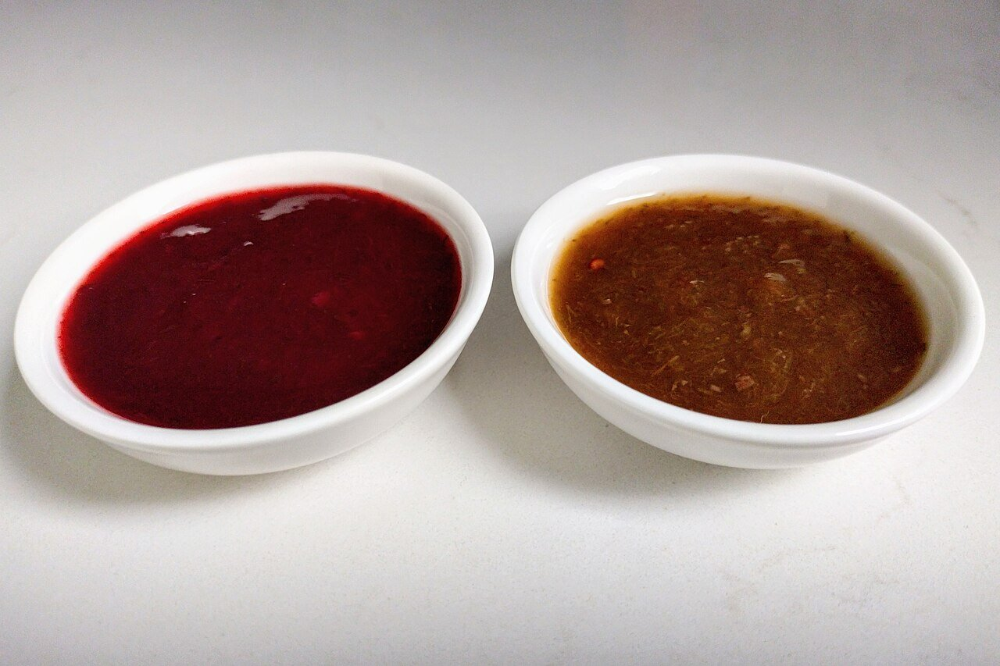

# Tkemali (salsa georgiana de ciruela)

*Foto: [Jelger Groeneveld](https://commons.wikimedia.org/wiki/File:Red_and_brown_tkemali.jpg), [CC BY 2.0](https://creativecommons.org/licenses/by/2.0/deed.es), vía Wikimedia Commons.*

Ciruelas ácidas cocidas y coladas con ajo, cilantro, eneldo y menta: la salsa georgiana de las brochetas (mtsvadi), las patatas y el pollo. En la foto, tkemali rojo y tkemali verde.

🥄 Para **1 tarro** (unos 400 ml) · ⏱️ 45 minutos · Dificultad: fácil

*In English:* [Tkemali (Georgian plum sauce)](tkemali.en.md)

## Ingredientes

- 1 kg de ciruelas ácidas (rojas o verdes, poco maduras)
- 100 ml de agua
- 4 dientes de ajo
- 1 manojo pequeño de cilantro
- 1 manojo pequeño de eneldo
- Unas hojas de menta (o poleo, el tradicional)
- 1 cucharadita de cilantro en grano molido
- 1 cucharadita de azúcar (al gusto)
- 1 cucharadita de sal
- Una pizca de guindilla (opcional)

## Preparación

1. **Cocer.** Pon las ciruelas enteras con el agua en una olla tapada y cuécelas 15 minutos, hasta que la piel se abra y la carne se deshaga.
2. **Colar.** Pásalas por un colador o pasapurés para quitar huesos y pieles.
3. **Reducir.** Vuelve a poner el puré al fuego con la sal, el azúcar y el cilantro molido, y cuece 15-20 minutos a fuego suave, removiendo, hasta que espese como un kétchup.
4. **Las hierbas.** Pica muy finos el ajo y las hierbas y añádelos al final, con la guindilla si la usas. Cuece 2 minutos más.
5. **Guardar.** Embótala en caliente en tarros limpios. Sírvela fría con carnes a la brasa.

## Consejos

- **Ciruelas ácidas:** las claudias verdes o las ciruelas rojas poco maduras van bien; si son dulces, añade zumo de limón.
- **Poco picante:** la guindilla es opcional; sin ella la salsa sigue siendo muy sabrosa.
- **Dura meses** en tarros bien cerrados; una vez abierto, 2 semanas en la nevera.
