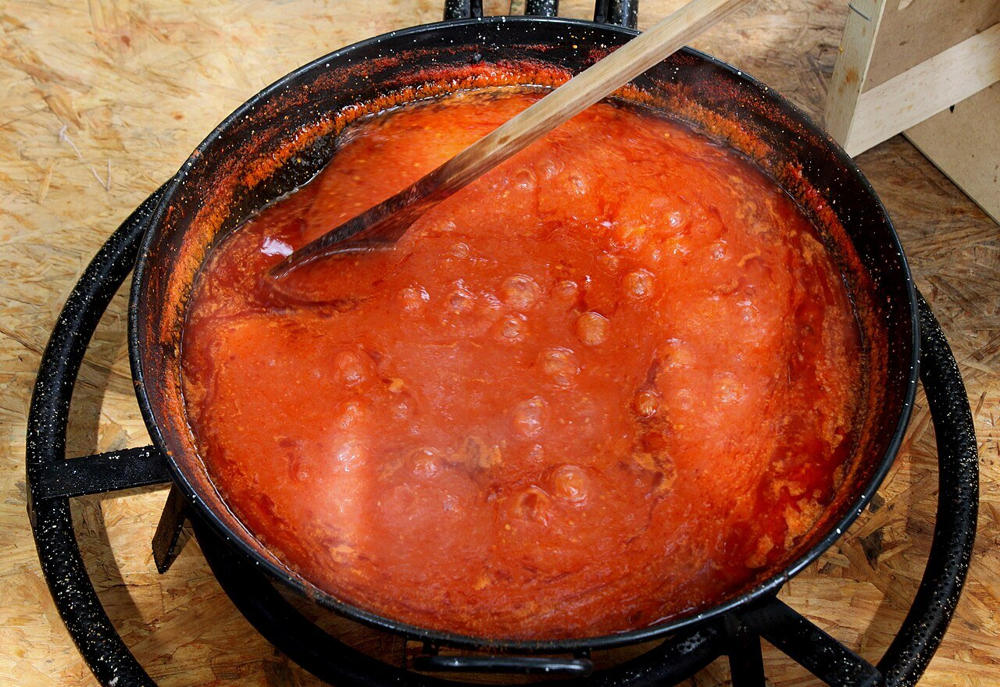

# Homemade Spanish tomato sauce

*Photo: [DnTrotaMundos ☮](https://commons.wikimedia.org/wiki/File:A_fuego_lento_con_el_tomate_previamente_pelado_y_triturado_para_as%C3%AD_hacer_una_buena_conserva_de_tomate_frito_y_abstenerse_a_comprarlo_en_ninguna_tienda_-_panoramio.jpg), [CC BY 3.0](https://creativecommons.org/licenses/by/3.0/), via Wikimedia Commons.*

Ripe tomatoes, onion and garlic slowly cooked in olive oil until thick and concentrated.

🥄 Makes **about 2½ cups** · ⏱️ 50 minutes · Difficulty: easy

*En español:* [Tomate frito casero](tomate-frito.es.md)

## Ingredients

- 2¼ lb ripe plum tomatoes
- 1 onion
- 2 garlic cloves
- 6 tablespoons olive oil
- 1 teaspoon sugar
- Salt

## Directions

1. **Chop.** Chop the onion and garlic. Cut the tomatoes into chunks.
2. **Soften.** Gently cook the onion and garlic for 10 minutes.
3. **Tomato.** Add the tomatoes, salt and sugar. Simmer gently for 40 minutes, stirring now and then, until thick.
4. **Pass.** Run it through a food mill to remove skins and seeds, or blend and strain.

## Tips

- **Sugar** balances acidity; taste before adding it.
- **To preserve:** process in sterilized jars in a water bath; it keeps for months.
- **Serve with** eggs, pasta, meatballs, vegetable stew or salt cod.
