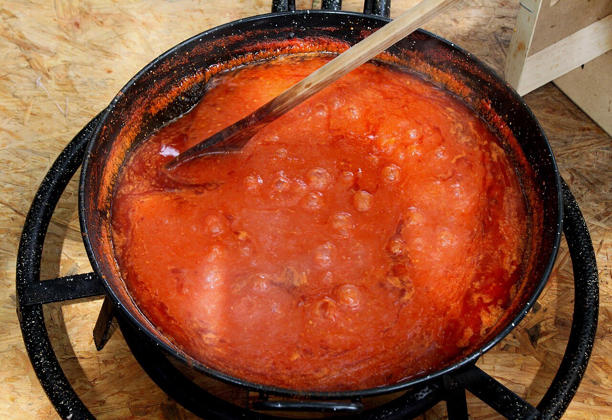

# Tomate frito casero

*Foto: [DnTrotaMundos ☮](https://commons.wikimedia.org/wiki/File:A_fuego_lento_con_el_tomate_previamente_pelado_y_triturado_para_as%C3%AD_hacer_una_buena_conserva_de_tomate_frito_y_abstenerse_a_comprarlo_en_ninguna_tienda_-_panoramio.jpg), [CC BY 3.0](https://creativecommons.org/licenses/by/3.0/deed.es), vía Wikimedia Commons.*

Tomate maduro, cebolla y ajo cocinados despacio en aceite de oliva hasta que se concentran.

🥄 Para **unos 600 g** · ⏱️ 50 minutos · Dificultad: fácil

*In English:* [Homemade Spanish tomato sauce](tomate-frito.en.md)

## Ingredientes

- 1 kg de tomates maduros (tipo pera)
- 1 cebolla
- 2 dientes de ajo
- 6 cucharadas de aceite de oliva
- 1 cucharadita de azúcar
- Sal

## Preparación

1. **Picar.** Pica la cebolla y el ajo. Trocea los tomates.
2. **Pochar.** Pocha la cebolla y el ajo a fuego suave 10 minutos.
3. **El tomate.** Añade los tomates, la sal y el azúcar. Cuece a fuego suave 40 minutos, removiendo de vez en cuando, hasta que espese.
4. **Pasar.** Pásalo por el pasapurés para quitar pieles y pepitas, o tritúralo y cuélalo.

## Consejos

- **El azúcar** corrige la acidez; pruébalo antes de añadirlo.
- **Conserva:** en tarros esterilizados y al baño maría, dura meses.
- **Con** huevos, macarrones, albóndigas, pisto o bacalao.
