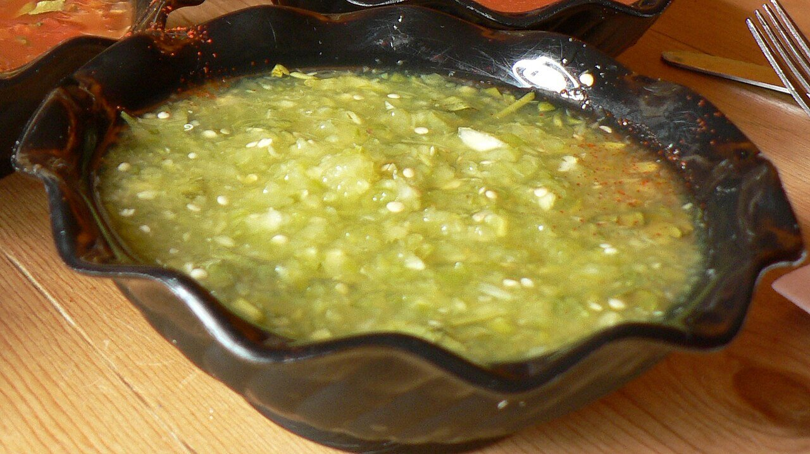

# Green tomatillo salsa

*Photo: [stu_spivack](https://commons.wikimedia.org/wiki/File:Salsa_verde.jpg), [CC BY-SA 2.0](https://creativecommons.org/licenses/by-sa/2.0/), via Wikimedia Commons.*

Boiled or charred tomatillos blended with onion, garlic and cilantro: Mexico's tangy, fresh salsa verde, mild if the chile is seeded.

🥄 Serves **4** · ⏱️ 15 minutes · Difficulty: easy · Heat: mild

*En español:* [Salsa verde de tomatillo](tomatillo.es.md)

## Ingredients

- 1 lb tomatillos
- ¼ white onion
- 1 garlic clove
- ½ serrano chile, seeded (optional)
- 1 handful cilantro
- Salt

## Directions

1. **Tomatillos.** Husk and rinse them. Simmer in water 5–7 minutes, until olive green, or char them on a comal.
2. **Blend.** Blend with the onion, garlic, chile, cilantro and salt, adding a little cooking water if needed.
3. **Taste.** Adjust the salt. If very tart, add a pinch of sugar.

## Tips

- **Serve with** tacos, chilaquiles verdes, enchiladas, quesadillas or eggs.
- **Creamier:** blend in half an avocado.
- **Keeps** 4–5 days in the fridge.
