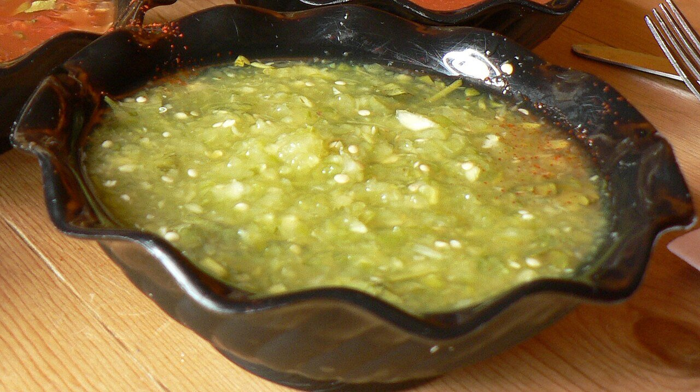

# Salsa verde de tomatillo

*Foto: [stu_spivack](https://commons.wikimedia.org/wiki/File:Salsa_verde.jpg), [CC BY-SA 2.0](https://creativecommons.org/licenses/by-sa/2.0/deed.es), vía Wikimedia Commons.*

Tomatillos cocidos o asados, triturados con cebolla, ajo y cilantro: la salsa verde mexicana, ácida y fresca, suave si el chile va sin semillas.

🥄 Para **4 personas** · ⏱️ 15 minutos · Dificultad: fácil · Picor: suave

*In English:* [Green tomatillo salsa](tomatillo.en.md)

## Ingredientes

- 500 g de tomatillos (tomates verdes)
- ¼ de cebolla blanca
- 1 diente de ajo
- ½ chile serrano sin semillas (opcional)
- 1 puñado de cilantro
- Sal

## Preparación

1. **Los tomatillos.** Quítales la cáscara y lávalos. Cuécelos en agua 5–7 minutos, hasta que cambien a verde oliva, o ásalos en el comal.
2. **Triturar.** Tritúralos con la cebolla, el ajo, el chile, el cilantro y la sal, con un poco del agua de cocción si hace falta.
3. **Probar.** Ajusta de sal. Si queda muy ácida, una pizca de azúcar.

## Consejos

- **Con** tacos, chilaquiles verdes, enchiladas, quesadillas o huevos.
- **Más cremosa:** tritúrala con medio aguacate.
- **Aguanta** 4–5 días en la nevera.
