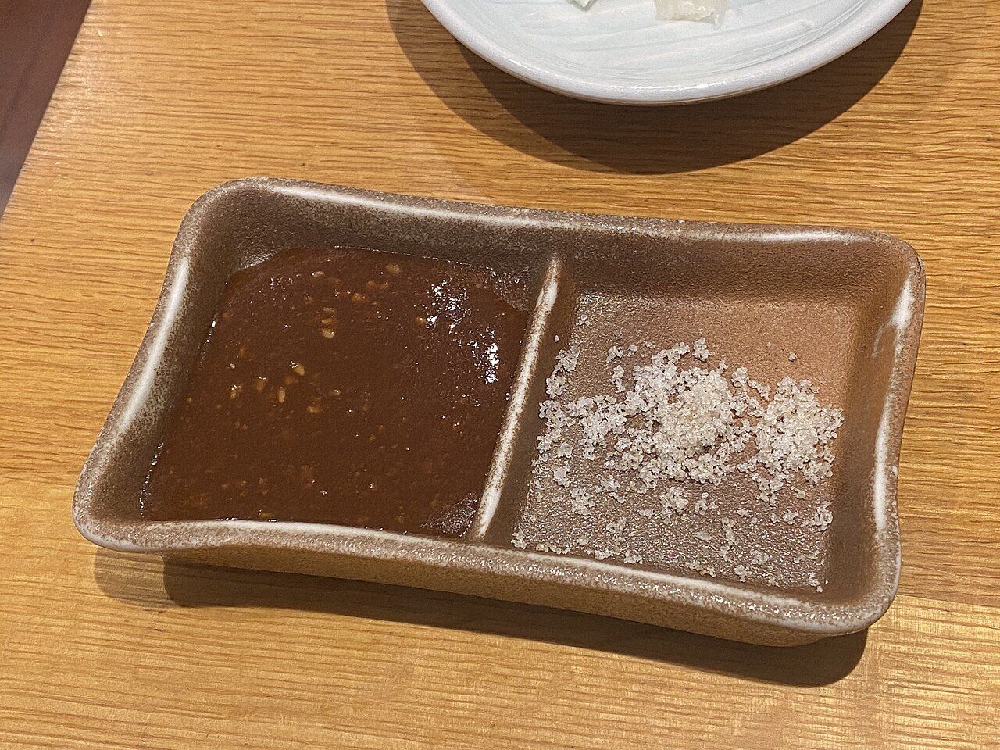

# Tonkatsu sauce with sesame

*Photo: [lazy fri13th](https://commons.wikimedia.org/wiki/File:Kurobuta_tonkatsu_tonbei_(53589512584).jpg), [CC BY 2.0](https://creativecommons.org/licenses/by/2.0/), via Wikimedia Commons.*

Ketchup, Worcestershire sauce, soy sauce and sugar, served with freshly ground sesame: the thick, fruity sauce for tonkatsu (breaded pork cutlet).

🥄 Serves **4** · ⏱️ 5 minutes · Difficulty: easy

*En español:* [Salsa tonkatsu con sésamo](tonkatsu.es.md)

## Ingredients

- 4 tablespoons ketchup
- 3 tablespoons Worcestershire sauce
- 1 tablespoon soy sauce
- 1 tablespoon sugar
- ½ teaspoon mustard (optional)
- 2 tablespoons toasted white sesame seeds, for grinding

## Directions

1. **Mix.** Stir together the ketchup, Worcestershire, soy sauce, sugar and mustard until the sugar dissolves.
2. **Rest.** Let it sit 10 minutes so the flavors meld.
3. **Sesame.** Serve the toasted sesame in a small mortar (suribachi) so everyone can grind it fresh.
4. **Serve.** Each person pours sauce over their ground sesame, stirs, and dips the tonkatsu.

## Tips

- **Serve with** tonkatsu, korokke (Japanese croquettes), breaded chicken or meat patties.
- **Not vegan:** Worcestershire sauce contains anchovies, unless you use a vegan brand.
- **Fruitier:** add 1 tablespoon grated apple or prune purée.
