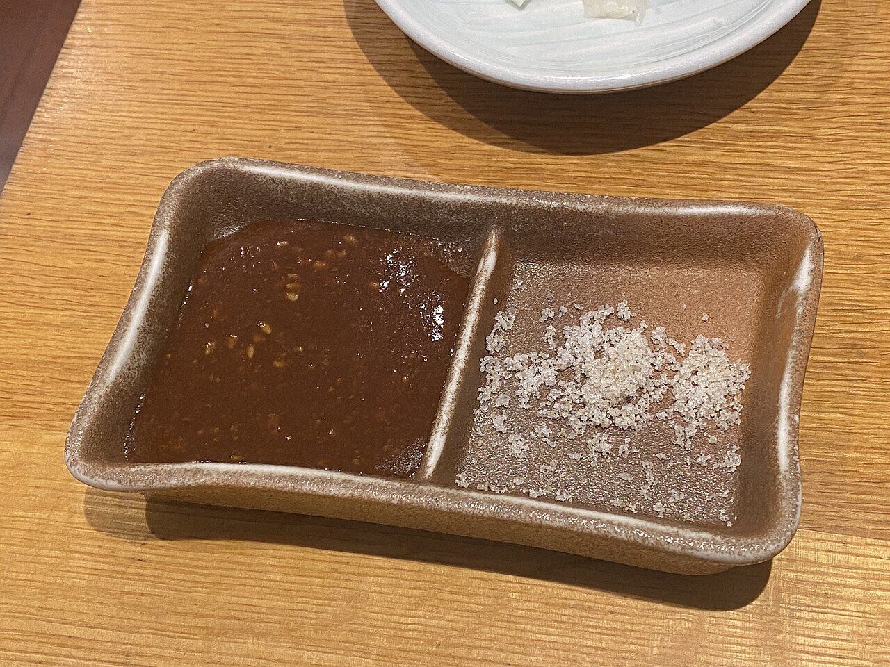

# Salsa tonkatsu con sésamo

*Foto: [lazy fri13th](https://commons.wikimedia.org/wiki/File:Kurobuta_tonkatsu_tonbei_(53589512584).jpg), [CC BY 2.0](https://creativecommons.org/licenses/by/2.0/deed.es), vía Wikimedia Commons.*

Kétchup, salsa Worcestershire, soja y azúcar, servidos con sésamo recién molido: la salsa espesa y afrutada del tonkatsu (filete de cerdo empanado).

🥄 Para **4 personas** · ⏱️ 5 minutos · Dificultad: fácil

*In English:* [Tonkatsu sauce with sesame](tonkatsu.en.md)

## Ingredientes

- 4 cucharadas de kétchup
- 3 cucharadas de salsa Worcestershire
- 1 cucharada de salsa de soja
- 1 cucharada de azúcar
- ½ cucharadita de mostaza (opcional)
- 2 cucharadas de sésamo blanco tostado, para moler

## Preparación

1. **Mezclar.** Mezcla el kétchup, la Worcestershire, la soja, el azúcar y la mostaza hasta que el azúcar se disuelva.
2. **Reposar.** Déjala 10 minutos para que se asienten los sabores.
3. **El sésamo.** Sirve el sésamo tostado en un mortero pequeño (suribachi) para que cada uno lo muela al momento.
4. **Servir.** Cada uno echa la salsa sobre su sésamo molido, mezcla y moja el tonkatsu.

## Consejos

- **Con** tonkatsu, korokke (croquetas japonesas), pollo empanado o filetes rusos.
- **Ojo, no es vegana:** la salsa Worcestershire lleva anchoas, salvo que sea una versión vegana.
- **Más afrutada:** añade 1 cucharada de manzana rallada o de puré de ciruelas.
