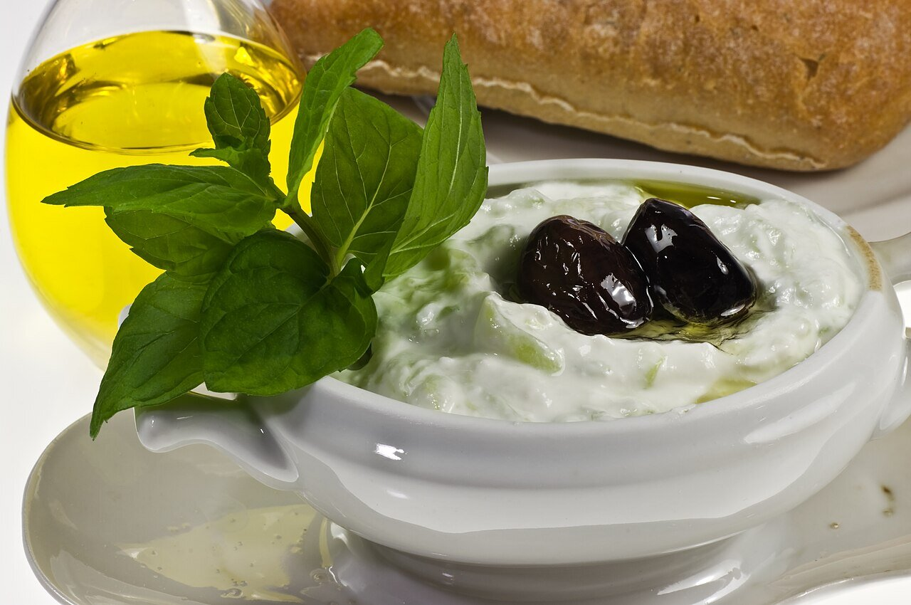

# Tzatziki

*Photo: [Nikodem Nijaki](https://commons.wikimedia.org/wiki/File:Tzatziki_meze_or_appetizer,_also_used_as_a_sauce.jpg), [CC BY-SA 3.0](https://creativecommons.org/licenses/by-sa/3.0/), via Wikimedia Commons.*

Thick Greek yogurt with grated cucumber, garlic, olive oil and dill: the cool sauce for souvlaki, gyros, fried vegetables and grilled meat.

🥄 Serves **4** · ⏱️ 15 minutes + 30 resting · Difficulty: easy

*En español:* [Tzatziki](tzatziki.es.md)

## Ingredients

- 1¾ cups full-fat Greek yogurt
- 1 medium cucumber
- 1 or 2 garlic cloves
- 2 tablespoons extra-virgin olive oil
- 1 tablespoon red wine vinegar or lemon juice
- 1 tablespoon chopped dill or mint
- Salt

## Directions

1. **Cucumber.** Grate it with the skin on, salt it lightly and leave it in a colander for 10 minutes. Then squeeze it dry by hand or in a towel.
2. **Garlic.** Grate or crush it with a pinch of salt.
3. **Mix.** In a bowl, stir together the yogurt, cucumber, garlic, vinegar and oil.
4. **Herbs.** Add the dill or mint and taste for salt.
5. **Rest.** Chill for at least 30 minutes so the garlic spreads through. Serve with a drizzle of oil and an olive.

## Tips

- **Squeeze the cucumber:** otherwise the tzatziki turns watery.
- **Thick yogurt:** if yours is runny, drain it in a cloth in the fridge for 2 hours.
- **Garlic grows:** it gets stronger as it rests; start with less.
