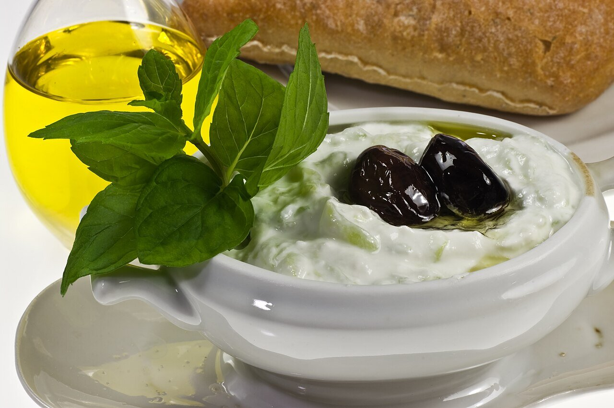

# Tzatziki

*Foto: [Nikodem Nijaki](https://commons.wikimedia.org/wiki/File:Tzatziki_meze_or_appetizer,_also_used_as_a_sauce.jpg), [CC BY-SA 3.0](https://creativecommons.org/licenses/by-sa/3.0/deed.es), vía Wikimedia Commons.*

Yogur griego espeso con pepino rallado, ajo, aceite de oliva y eneldo: la salsa fresca de los souvlakis, el gyros, las verduras fritas y las carnes a la brasa.

🥄 Para **4 personas** · ⏱️ 15 minutos + 30 de reposo · Dificultad: fácil

*In English:* [Tzatziki](tzatziki.en.md)

## Ingredientes

- 400 g de yogur griego (10 % de grasa)
- 1 pepino mediano
- 1 o 2 dientes de ajo
- 2 cucharadas de aceite de oliva virgen extra
- 1 cucharada de vinagre de vino o zumo de limón
- 1 cucharada de eneldo o menta picados
- Sal

## Preparación

1. **El pepino.** Rállalo con piel, sálalo un poco y déjalo 10 minutos en un colador. Luego exprímelo bien con las manos o un paño.
2. **El ajo.** Rállalo o machácalo con una pizca de sal.
3. **Mezclar.** En un cuenco, mezcla el yogur con el pepino, el ajo, el vinagre y el aceite.
4. **Las hierbas.** Añade el eneldo o la menta y prueba de sal.
5. **Reposar.** Déjalo en la nevera al menos 30 minutos para que el ajo se reparta. Sírvelo con un chorrito de aceite y una aceituna.

## Consejos

- **Escurre el pepino:** si no, el tzatziki se agua.
- **Yogur espeso:** si el tuyo es líquido, escúrrelo en un paño 2 horas en la nevera.
- **El ajo crece:** con el reposo sabe más; empieza con poco.
