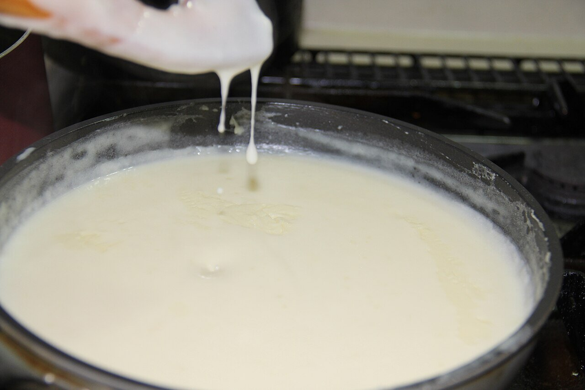

# Velouté sauce

*Photo: [Roozitaa](https://commons.wikimedia.org/wiki/File:Making_White_sauce_5.jpg), [CC BY-SA 3.0](https://creativecommons.org/licenses/by-sa/3.0/), via Wikimedia Commons.*

A blond roux simmered with light chicken, veal or fish stock: the lightest French mother sauce. The photo shows a white sauce being cooked.

🥄 Makes **about 2 cups** · ⏱️ 25 minutes · Difficulty: easy

*En español:* [Salsa velouté](veloute.es.md)

## Ingredients

- 3 tablespoons butter
- ⅓ cup all-purpose flour
- 2½ cups light stock (chicken, veal or fish), hot
- A few drops lemon juice
- Salt and white pepper

## Directions

1. **Roux.** Melt the butter over medium-low heat, add the flour and cook 2–3 minutes, stirring, until very pale golden.
2. **Stock.** Gradually whisk in the hot stock.
3. **Simmer.** Simmer gently for 15 minutes, skimming, until it coats a spoon.
4. **Finish.** Strain, add a few drops of lemon and season.

## Tips

- **With fish stock** it's the base for white wine sauce; with chicken stock, for sauce suprême (with cream).
- **Serve with** poached chicken, steamed fish, vol-au-vent or vegetables.
- **Stock is key:** the better the stock, the better the sauce.
